# Playzy: Free TikTok LIVE Gifts to Game Actions for GTA V, Minecraft and Any PC Game (Windows)

**Playzy** is a free Windows app that turns your TikTok LIVE into a game your viewers play with you. A Rose gives
you a speed boost in GTA V, a Doughnut drops a creeper next to you in Minecraft, and every 300 likes makes your
character jump in whatever game is open. It reads gifts, likes, follows, shares and chat, runs the actions in your
game, and gives you an overlay for TikTok LIVE Studio or OBS. No event limits, no watermark, no account.

**Your viewers play. Free.**

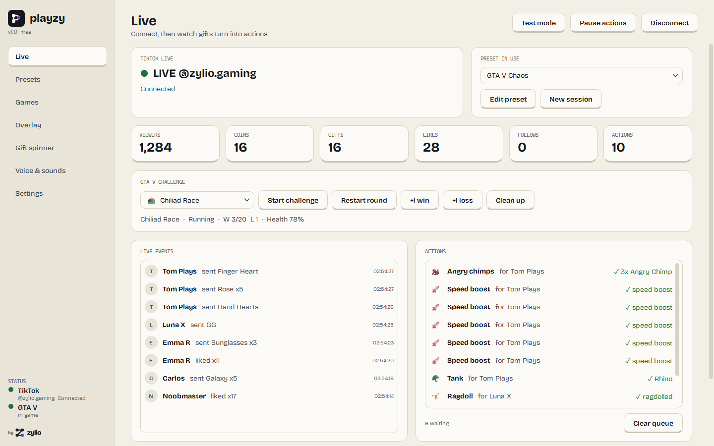

**First time?** The [step-by-step user guide](guide/playzy-guide.md) takes you from installing Playzy to your first LIVE, with a picture for every step.

---

## Key features

| | |
|---|---|
| 🎁 **Gifts, likes, follows, chat** | A rule per gift, any gift above a coin value, every N likes, follows, shares, joins, or a chat command like `!spin`. A rule can run several actions in a row, speak a line and play a sound. |
| 🚗 **GTA V Story Mode** | Playzy's own script with 53 effects (tanks, jets, chimps, Ballas, meteors, a black hole, low gravity, jail…) and 16 challenges with a win/loss score: the Chiliad Race, Zombie Apocalypse, a Boss Fight with its health bar on the overlay, Gun Game, Bounty Hunt and more. Playzy finds your GTA V folder and installs the script with one button. |
| 🧟 **Viewers play the challenge** | 12 gift actions made for the challenges: send a zombie horde, heal the boss, add or steal time, reveal the bounty. Outside their challenge each does something else useful. Enemies a viewer sends carry that viewer's name over their heads. In Chaos Roulette the game spins the wheel on your overlay itself. |
| ⛏️ **Minecraft Java** | Mobs, TNT, lightning, potion effects, items, weather, or any server command, over RCON. Works with a server on your PC or a rented one. |
| ⌨️ **Any PC game** | Gifts press and hold keys, type, click and move the mouse. Keys only go to your game's window, so a gift never types into your browser. |
| 📺 **Overlay** | One link for TikTok LIVE Studio or OBS, portrait 1080 × 1920 or landscape 1920 × 1080: what each gift does, alerts with combos, the gift spinner, a like goal, top gifters and a game HUD. Or add each part on its own. |
| 🎡 **Gift spinner** | A wheel on the overlay that picks a random action, for a gift or the `!spin` command. |
| 🗣️ **Voice** | Reads each rule's line, or chat, with the voices Windows already has. |
| 💸 **Gifts are never thrown away** | A gift that comes in during a cooldown waits its turn, and waits for the game if it is closed for a moment. Free likes and chat are skipped instead, so a like storm can't bury the game. |
| 🧪 **Test mode** | Fake viewers send gifts, likes and chat through your preset, exactly like real ones, before you go live. |
| 🧩 **Webhook and Mod SDK** | Call any URL with the viewer's details, or connect a mod for another game over a local WebSocket. |

---

## Screenshots

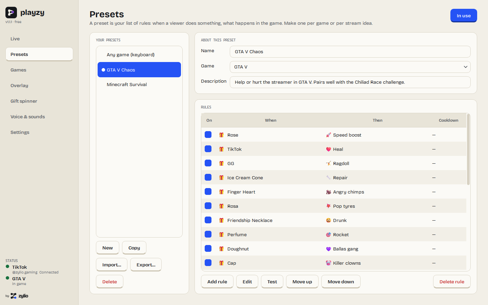 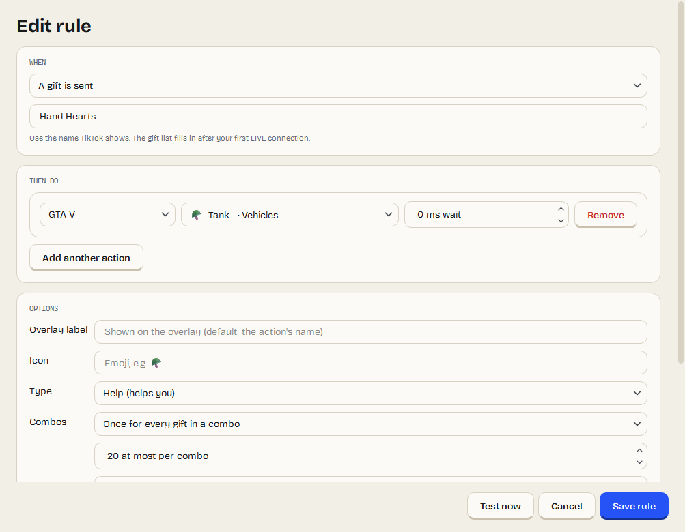

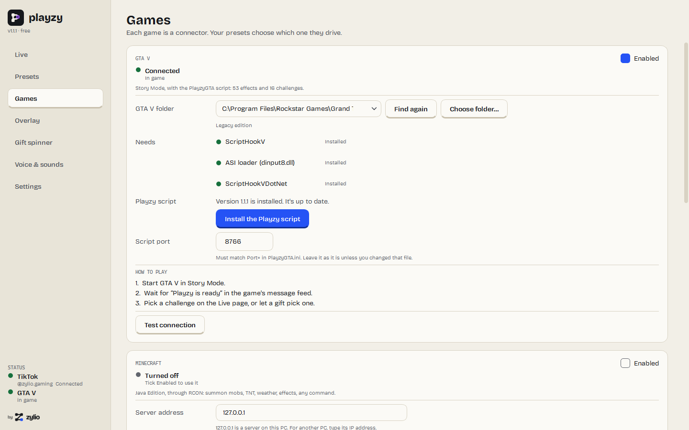 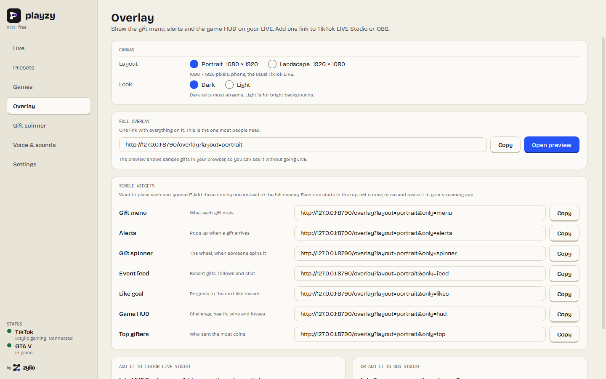

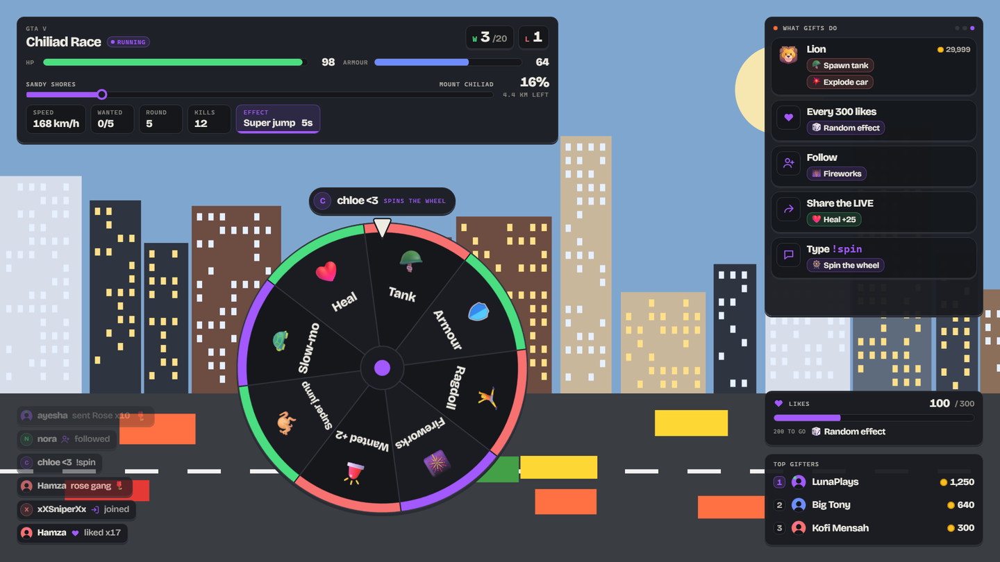 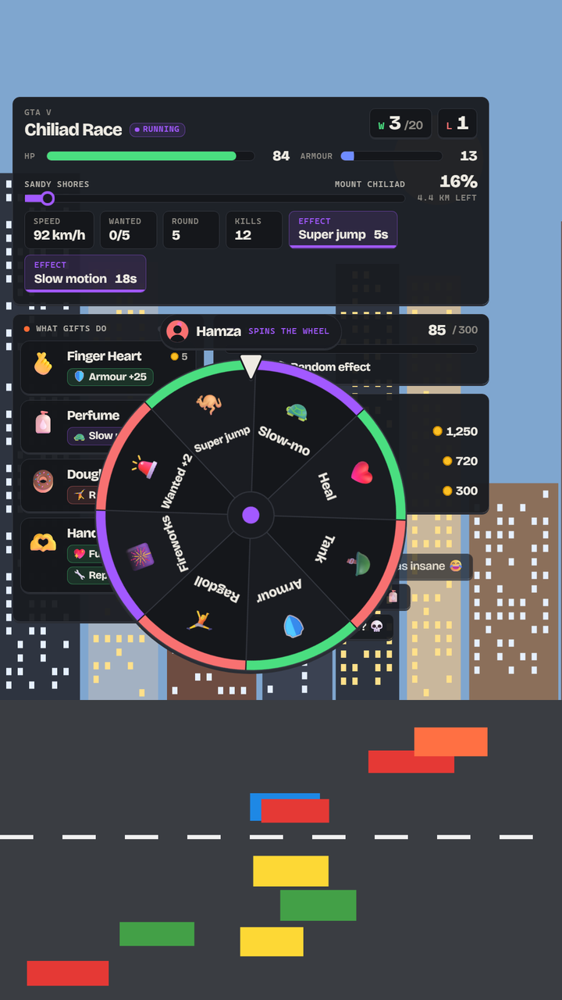

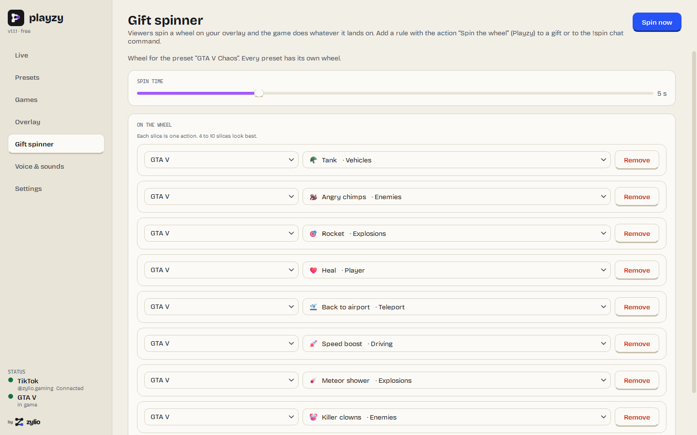 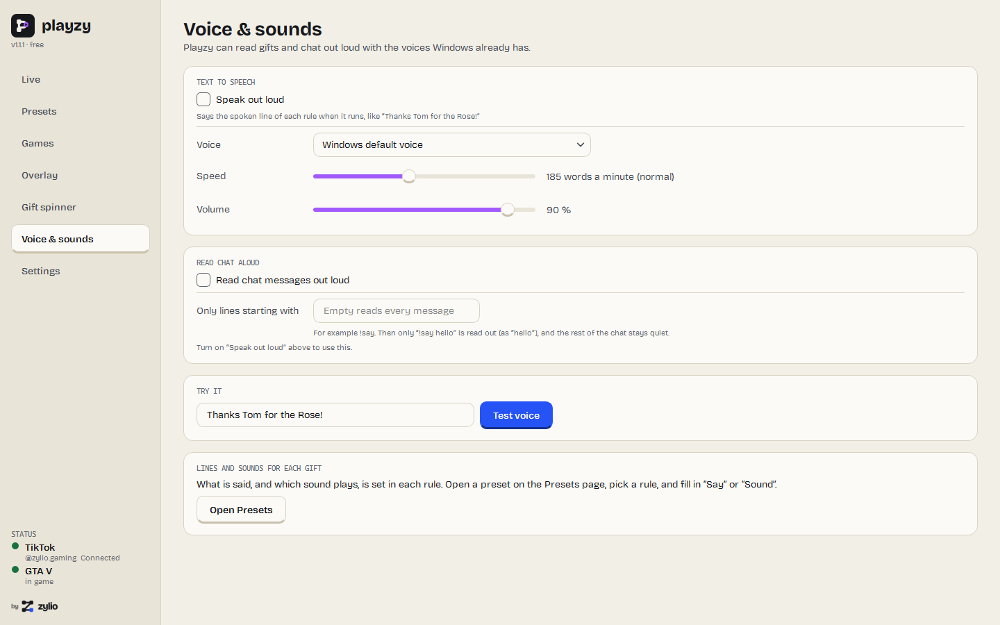

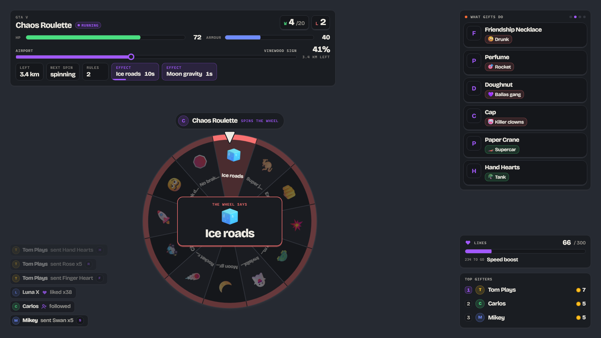 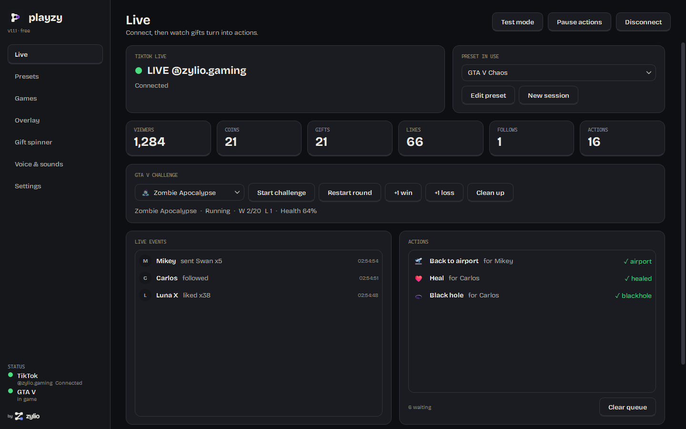

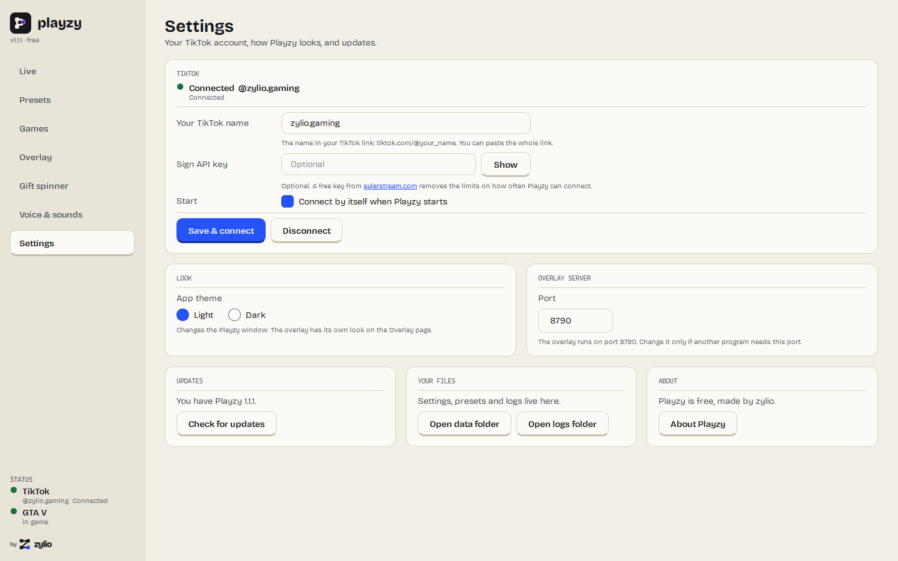 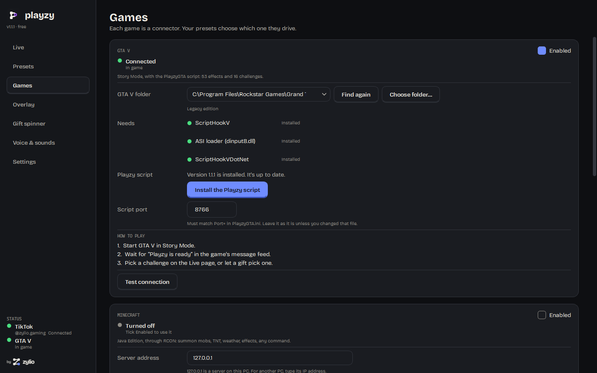

---

## Download & install

Everything is on the **[Releases](../../releases)** page.

| Download | Platform |
|---|---|
| `PlayzySetup.exe` | **Windows 10/11** (64-bit): run the installer |

Windows asks for permission to install, because Playzy goes into Program Files. Playzy updates itself after that: when a new version is out it shows what's new and asks first.

For GTA V you also need [ScriptHookV](http://www.dev-c.com/gtav/scripthookv/) and [ScriptHookVDotNet 3](https://github.com/scripthookvdotnet/scripthookvdotnet/releases). For Minecraft, a Java server with RCON turned on. Any other game needs nothing extra. The [user guide](guide/playzy-guide.md) has every step.

---

## FAQ

**What does it cost?**
Nothing. There is no limit on events or presets and no watermark. The gift spinner, text to speech and the overlay are free too.

**Does it need an account?**
No Playzy account, ever. Playzy needs only your TikTok name. It never asks for your TikTok password.

**How does it read my LIVE?**
TikTok has no public API for LIVE events. Playzy uses the open-source [TikTokLive](https://github.com/isaackogan/TikTokLive)
library, which signs each connection through the [Euler Stream](https://www.eulerstream.com) service. The free signing
has a rate limit: connect and disconnect many times and Playzy waits 3 minutes. A free key from Euler Stream removes
that. When TikTok changes its site, connecting can break until the library catches up.

**Can I get banned in GTA V?**
Use Playzy only in Story Mode. Mods in GTA Online get accounts banned, and the script doesn't stop you going online.

**Does it work with Kick, YouTube or Twitch?**
Not yet. Only TikTok for now.

**Does Playzy stream my video?**
No. You go live with TikTok LIVE Studio or OBS as before. Playzy reads the LIVE, drives the game and serves the
overlay on your own PC.

**Does it phone home?**
No telemetry and no analytics. Playzy connects to TikTok (through TikTokLive and Euler Stream), to GitHub to look for
updates, and to the Minecraft servers and webhooks you set up. Details are in the [privacy policy](privacy-policy.html).

**Windows says "Windows protected your PC". Is it safe?**
That's Microsoft SmartScreen. It appears for new apps that aren't code-signed yet, and Playzy isn't yet. Click
**More info**, then **Run anyway**.

**Is it open source?**
Playzy is released under the MIT licence. This repository holds the builds, the user guide and this page.

---

## Support this project

Playzy is built by one person. If it made your LIVE more fun, you can chip in:

### ❤️ [patreon.com/zylio](https://www.patreon.com/zylio)

**Nothing is locked behind it.** Every feature is available to everyone, whether or not anybody ever contributes. There will not be a supporters-only build.

---

**Keywords:** TikTok LIVE interactive game, TikTok gifts control game, TikTok LIVE GTA V mod, GTA 5 TikTok gifts,
Minecraft TikTok LIVE, TikTok LIVE Studio overlay, gift alerts, gift spinner, like goal, TikTok LIVE text to speech,
viewers control my game, free StreamToEarn alternative, TikTok chat commands,
no watermark, no subscription, Windows.

---

Built by **[zylio](https://zylio.net)**, an independent software studio making fast, honest tools.

**Product page:** [zylio.net/software/playzy](https://zylio.net/software/playzy)

© 2026 zylio · Faisal Malik. Playzy is free software under the MIT licence.
