# Playzy user guide

Playzy is a free Windows app that connects your TikTok LIVE to the game you are playing. A viewer sends a Rose and you get a speed boost in GTA V. Someone sends a Doughnut and a creeper spawns next to you in Minecraft. Every 300 likes, your character jumps in whatever game is open.

Playzy does not stream your video. You still go live with TikTok LIVE Studio (or OBS). Playzy reads what happens on your LIVE, runs the actions in your game, and gives you an overlay to put on top of the stream.

This guide goes from nothing to your first LIVE, then explains every page. If you are new, read **Part 1**, the part for your game in **Part 2**, and **Part 3**. The rest is there when you need it.

In the pictures, **blue numbered boxes** show what to click. The numbers match the steps under each picture. The pictures were made with a stand-in game and fake viewers: the TikTok name, the viewers and the game state are examples.

## Contents

**Part 1. Get started**
1. [What you need](#1-what-you-need)
2. [Install Playzy](#2-install-playzy)
3. [The first start](#3-the-first-start)
4. [Connect your TikTok](#4-connect-your-tiktok)

**Part 2. Set up your game**
5. [GTA V](#5-gta-v)
6. [Minecraft](#6-minecraft)
7. [Any game, with the keyboard and mouse](#7-any-game-with-the-keyboard-and-mouse)
8. [Webhook](#8-webhook)
9. [Mod SDK](#9-mod-sdk)

**Part 3. Put it on your stream**
10. [Add the overlay to TikTok LIVE Studio or OBS](#10-add-the-overlay-to-tiktok-live-studio-or-obs)

**Part 4. Decide what viewers can do**
11. [Presets](#11-presets)
12. [Rules](#12-rules)
13. [The gift spinner](#13-the-gift-spinner)
14. [Voice and sounds](#14-voice-and-sounds)

**Part 5. Go live**
15. [Try everything in Test mode](#15-try-everything-in-test-mode)
16. [Go live](#16-go-live)
17. [The Live page while you stream](#17-the-live-page-while-you-stream)
18. [GTA V challenges](#18-gta-v-challenges)

**Part 6. Help**
19. [If something goes wrong](#19-if-something-goes-wrong)
20. [Updating and uninstalling](#20-updating-and-uninstalling)
21. [Privacy and where your files are](#21-privacy-and-where-your-files-are)
22. [Questions people ask](#22-questions-people-ask)
23. [Words you will see](#23-words-you-will-see)
24. [Get help](#24-get-help)

---

# Part 1. Get started

## 1. What you need

**For everyone**
- **A Windows PC** with Windows 10 or Windows 11, 64-bit. There is no Mac or Linux version.
- **A TikTok account that can go LIVE.**
- **TikTok LIVE Studio or OBS Studio** on the same PC, to stream and to show the overlay.

**For GTA V**
- **GTA V for PC**, played in **Story Mode**. Legacy and Enhanced both work. Playzy finds the game in Steam, the Rockstar Games Launcher or Epic.
- **[ScriptHookV](http://www.dev-c.com/gtav/scripthookv/)**. Its download also has the ASI loader, `dinput8.dll`.
- **[ScriptHookVDotNet 3](https://github.com/scripthookvdotnet/scripthookvdotnet/releases)**.

Section 5 shows how to install them. Never use mods in GTA Online. Rockstar bans accounts for it.

**For Minecraft**
- **Minecraft Java Edition**, playing on a server with **RCON** turned on. That can be a server on your own PC, a rented one, or your world opened with the server jar. Bedrock Edition has no RCON, so it doesn't work.

**For any other game**
- Nothing else. Playzy presses keys and moves the mouse.

## 2. Install Playzy

1. Download **PlayzySetup.exe** from [zylio.net/software/playzy](https://zylio.net/software/playzy) or from the [releases page](https://github.com/faisalrasheed442/playzy-public/releases/latest). It is one file.
2. Open the file. Windows asks for permission to install, because Playzy goes into Program Files. Click **Yes**.
3. If Windows shows **"Windows protected your PC"**, click **More info**, then **Run anyway**. Playzy's installer isn't code-signed yet, and SmartScreen warns about new unsigned apps.
4. Follow the installer. You can tick **Create a desktop shortcut**.
5. On the last page, leave **Launch Playzy** ticked and click **Finish**.

> Playzy installs to `C:\Program Files\Playzy`. Your settings, presets and logs are kept separately in `%LOCALAPPDATA%\Playzy`, so an update or a reinstall never touches them.

## 3. The first start

Playzy opens on the **Live** page. Playzy has already added three presets for you: **GTA V Chaos** (the one in use), **Minecraft Survival** and **Any game (keyboard)**.

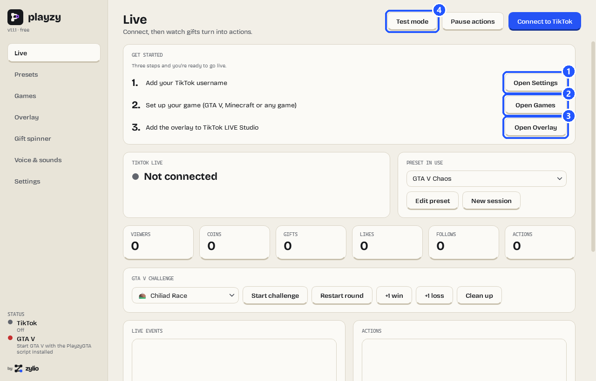

The **Get started** card lists the three things to do before your first LIVE:

1. **Open Settings** and add your TikTok name ([section 4](#4-connect-your-tiktok)).
2. **Open Games** and set up your game ([Part 2](#part-2-set-up-your-game)).
3. **Open Overlay** and add the overlay to TikTok LIVE Studio ([section 10](#10-add-the-overlay-to-tiktok-live-studio-or-obs)).
4. **Test mode** lets you try everything with fake viewers, before you go live ([section 15](#15-try-everything-in-test-mode)).

The card goes away once your TikTok name is saved.

The pages are in the sidebar on the left: **Live**, **Presets**, **Games**, **Overlay**, **Gift spinner**, **Voice & sounds** and **Settings**. At the bottom, **STATUS** shows whether TikTok and your game are connected.

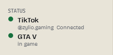

A green dot means connected. Orange means connecting or waiting. Red means there is a problem, and the line under it says what.

## 4. Connect your TikTok

Playzy only needs your TikTok name. It never asks for your TikTok password and never logs in to your account.

Open **Settings**.

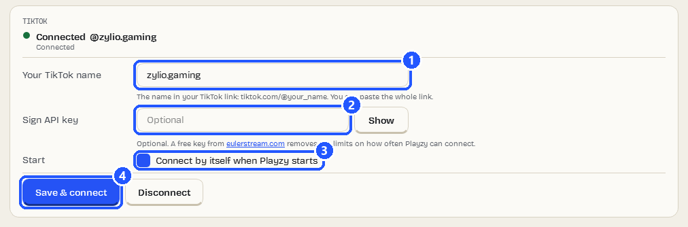

1. **Your TikTok name:** the name in your TikTok link, `tiktok.com/@your_name`, without the @. You can also paste the whole link; Playzy keeps only the name.
2. **Sign API key:** optional. Leave it empty to start. See [below](#why-there-is-a-sign-api-key) for what it is.
3. **Connect by itself when Playzy starts:** on by default. Playzy then connects every time it opens.
4. Click **Save & connect**.

If you are not LIVE yet, the status says **Waiting for you to go LIVE**. That is normal. Playzy keeps trying by itself: after 15 seconds at first, then less often, and at most every 3 minutes. When it is connected, the status says **Connected** with your name.

After the first connection, Playzy knows the gift names and prices for your region. From then on, the rule editor suggests gift names as you type.

### Why there is a Sign API key

TikTok has no public way for apps to read LIVE gifts. Playzy uses [TikTokLive](https://github.com/isaackogan/TikTokLive), an open-source library, to connect the same way the TikTok website does. Each connection has to be signed first, and TikTokLive asks the [Euler Stream](https://www.eulerstream.com) signing service to do that.

The free signing has a limit on how often you can connect. If you connect and disconnect many times in a row, Playzy says **"TikTok sign server is busy"** and waits 3 minutes before it tries again. A free key from [eulerstream.com](https://www.eulerstream.com) removes that limit. Paste it into **Sign API key** and click **Save & connect** again.

### The rest of Settings

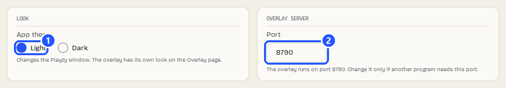

1. **App theme:** Light or Dark, for the Playzy window. The overlay has its own look on the Overlay page.
2. **Port:** the overlay server's port, 8790. Change it only if another program needs that port (see [section 19](#19-if-something-goes-wrong)).

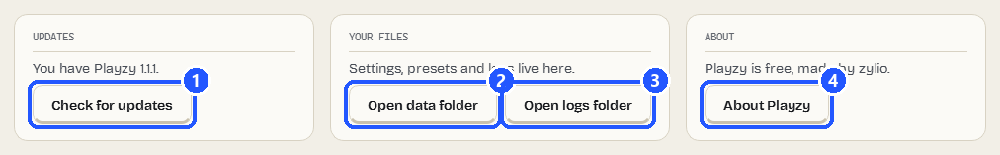

1. **Check for updates** asks GitHub whether a newer Playzy is out.
2. **Open data folder** opens `%LOCALAPPDATA%\Playzy`, with your settings and presets.
3. **Open logs folder** opens the logs, for when something goes wrong.
4. **About Playzy** shows the version and who makes it.

---

# Part 2. Set up your game

Each game is a **connector** on the **Games** page. A preset says which game it is made for. You only need to set up the games you play.

## 5. GTA V

Playzy talks to GTA V through its own script, `PlayzyGTA.3.cs`, which runs inside the game. The script needs two free mod loaders. Playzy checks for them and shows what is missing.

### Step 1: Install ScriptHookV

1. Close GTA V.
2. Download ScriptHookV from [dev-c.com/gtav/scripthookv](http://www.dev-c.com/gtav/scripthookv/).
3. Open the zip. From its `bin` folder, copy **ScriptHookV.dll** and **dinput8.dll** into your GTA V folder (the folder with `GTA5.exe` in it).

`dinput8.dll` is the **ASI loader**. Without it, ScriptHookVDotNet never starts.

### Step 2: Install ScriptHookVDotNet 3

1. Download the latest ScriptHookVDotNet from its [releases page](https://github.com/scripthookvdotnet/scripthookvdotnet/releases).
2. Unzip everything into the same GTA V folder. Playzy looks for `ScriptHookVDotNet.asi` there.

ScriptHookVDotNet's page also lists what it needs from Windows (a recent .NET Framework and the Visual C++ runtime). Most PCs already have them.

> **GTA V Enhanced** needs ScriptHookV and ScriptHookVDotNet versions that support Enhanced. Check their pages for which build to download.

### Step 3: Let Playzy install its script

Open **Games**. Playzy looks for GTA V on your PC by itself.

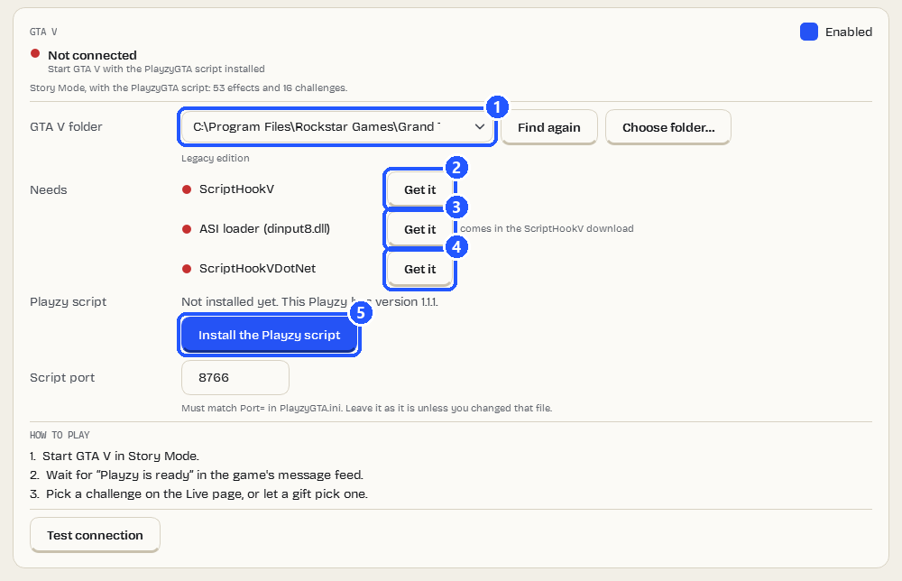

1. **GTA V folder:** the folder Playzy found, and under it whether it is the Legacy or Enhanced edition. If it is wrong or empty, click **Choose folder…** and pick the folder with `GTA5.exe` in it. **Find again** looks once more.
2. **Get it** next to **ScriptHookV** opens its download page. A red dot means Playzy can't find it in the GTA V folder.
3. **Get it** next to the **ASI loader** opens the same page, because `dinput8.dll` comes in the ScriptHookV download.
4. **Get it** next to **ScriptHookVDotNet** opens its releases page.
5. Click **Install the Playzy script**. Playzy copies `PlayzyGTA.3.cs` and `PlayzyGTA.ini` into the `scripts` folder inside your GTA V folder, and makes that folder if it isn't there.

If you already have a `PlayzyGTA.ini`, Playzy asks whether to **Keep my settings** or **Use the defaults**. If Windows doesn't let Playzy write into the GTA V folder, close GTA V and try again, or run Playzy as administrator once.

**Older gift scripts.** Some older TikTok scripts for GTA V, like `GiftEffects.cs`, use the same port as Playzy's script (8766) and can stop it from starting. If Playzy finds one in your `scripts` folder, the card names it and the button says **Install and fix**. That moves the old script into the `Playzy - disabled scripts` folder next to GTA5.exe (outside `scripts`, so it really stops loading). Nothing is deleted, so you can move it back later.

### Step 4: Start the game

1. Start GTA V and load **Story Mode**.
2. Wait for **"Playzy is ready. Effects and challenges are live."** in the game's message feed.
3. Look at the GTA V card in Playzy:

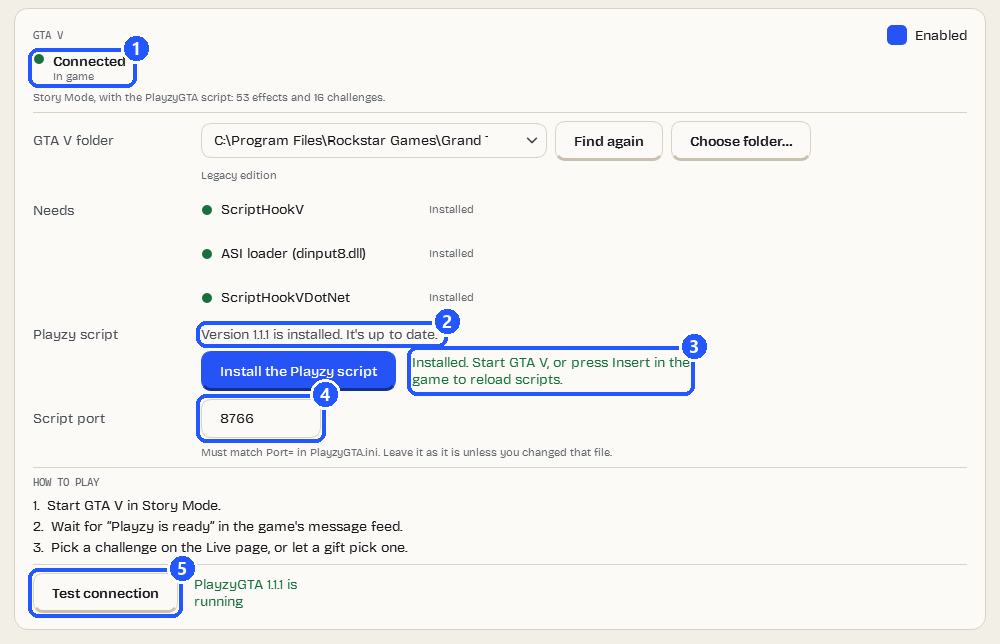

1. The status says **Connected** and **In game**.
2. **Playzy script** says which version is installed, and whether it is up to date.
3. After installing, Playzy reminds you: start GTA V, or press **Insert** in the game to reload scripts.
4. **Script port:** 8766. It must match `Port=` in `PlayzyGTA.ini`. Leave both alone. If another mod already uses 8766, the script moves to 8767, 8768, 8769 or 8770, or as a last resort to any free port, which it writes into `scripts\PlayzyGTA.port`. Playzy finds it there by itself.
5. **Test connection** checks that Playzy can reach the script right now. It says **PlayzyGTA** and the script's version, then **is running**, when it works. It also says which port it found the script on, if that isn't 8766.

The pictures were made with an earlier Playzy, so the version numbers and the counts in them (16 challenges, 53 effects) are older than this guide.

### Playzy keeps the script up to date

When Playzy starts, it checks the script in your GTA V folder. If that script is older than the one inside Playzy (after a Playzy update, for example), Playzy replaces it by itself. Your `PlayzyGTA.ini` and its settings stay as they are.

If GTA V is already running at that moment, the game still runs the old script. The game and the Games page both tell you, for example *old script 1.1.0 running: press Insert in GTA V to load the new one*. Press **Insert** in the game once.

You can still update by hand: on the Games page the button then says **Update the Playzy script**.

### Story Mode only

Use Playzy only in Story Mode. Rockstar bans accounts that use mods in GTA Online, and the Playzy script doesn't stop you going online. If you also play GTA Online, take the ScriptHookV files out of the GTA V folder first.

### The car radio stays off

`RadioOff=true` in `PlayzyGTA.ini` keeps the car radio off. GTA's radio plays real songs, and TikTok mutes or strikes LIVEs with copyrighted music.

### Hotkeys

You can fire effects yourself from the keyboard, without a numpad. **Hold Ctrl+Shift and press the key:**

| Key | Does | Key | Does |
|---|---|---|---|
| **Home** | Tank | **1** | Heal |
| **End** | Supercar | **2** | Rocket |
| **Page Up** | Angry chimps | **3** | Airstrike |
| **Page Down** | Ballas gang | **4** | Skydive |
| **Delete** | Delete vehicle | **5** | Back to airport |
| **Backspace** | Clean up everything viewers spawned | **6** | Speed boost |
| **R** | Restart the round | **7** | One-hit KO |
| | | **8** | Jail |
| | | **9** | Low gravity |
| | | **0** | Repair |

The numbers are the ones above the letters. To change a key, open `PlayzyGTA.ini` in the `scripts` folder, edit the `[Hotkeys]` part, save, and press **Insert** in the game. A key can run an effect name (like `tank`) or a command: `!restart`, `!stop`, `!cleanup`, `!win`, `!loss`, or `!mode:taxi` to switch challenge. **Insert** and **F4** can't be used, because ScriptHookVDotNet already uses them.

### The 56 effects

| Group | Effects |
|---|---|
| Vehicles | Tank, Supercar, Monster truck, Fighter jet, Attack heli, BMX bike, Clown van |
| Driving | Speed boost, Repair, Delete vehicle, Pop tyres, Flip vehicle, Launch |
| Player | Heal, Invincible 15 s, Weapons, Bodyguards, Clear wanted, One-hit KO, Ragdoll, Drunk, Low gravity, 5 stars |
| Teleport | Skydive, Back to airport, Jail, Random teleport |
| Explosions | Rocket, Airstrike, Meteor shower, Black hole |
| Enemies | Angry chimps, Ballas gang, Killer clowns, Aliens, Zombies, SWAT team, Juggernaut |
| World | Thunderstorm, Night, Day |
| Challenges | Zombie horde, Supply drop, Rammer car, Spin the roulette, Heal the boss, Boss rage, Reveal the target, Armour the target, Weapon up, Weapon down, Add time, Steal time, Join the challenge, Join the red team, Join the blue team |

The 15 in **Challenges** are made for certain challenges ([section 18](#gift-actions-made-for-the-challenges)). The three **Join** actions let a viewer join Battle Royale, Viewer Racers or Team War; viewers can also do that by typing in chat, with no rule ([section 18](#viewers-join-from-the-chat)).

In a challenge, a gift only runs if it fits that challenge. If it doesn't, the challenge runs its stand-in instead ([section 18](#which-gifts-work-in-each-challenge)). In free play every effect runs.

An effect sent while you are dead or the game is loading waits (up to 60 seconds) instead of being thrown away. When a viewer sends enemies, their name floats over those enemies' heads in the game, like **tom_plays's Zombie**, and the map marker says who sent them too.

The challenges are explained in [section 18](#18-gta-v-challenges).

## 6. Minecraft

Playzy sends commands to a Minecraft Java server through **RCON**, the server's remote console. This works with a server on your PC, a rented server, or your own world opened with the server jar.

### Step 1: Turn on RCON

1. Stop the server.
2. Open `server.properties` in the server's folder.
3. Set these three lines. Pick your own password:

   ```
   enable-rcon=true
   rcon.port=25575
   rcon.password=pick-a-password
   ```
4. Save the file and start the server again.

### Step 2: Fill in the Minecraft card

Open **Games** and scroll to **Minecraft**.

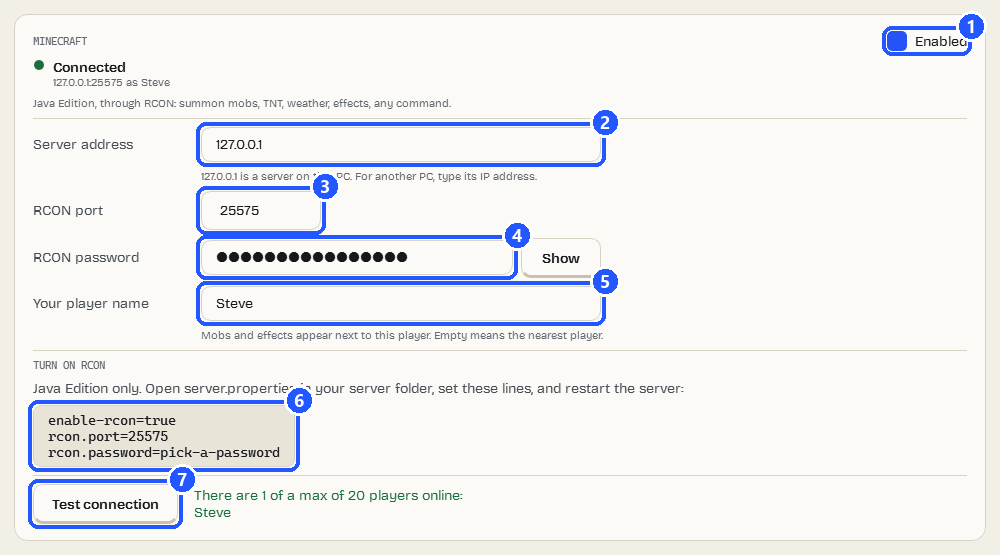

1. **Enabled** must be ticked.
2. **Server address:** `127.0.0.1` for a server on this PC. For a server somewhere else, type its IP address.
3. **RCON port:** the same as `rcon.port`, normally 25575.
4. **RCON password:** the same as `rcon.password`. **Show** shows what you typed.
5. **Your player name:** your Minecraft name. Mobs and effects appear next to this player. If you leave it empty, they go to the nearest player.
6. These are the lines to put in `server.properties`. They follow the port you type above.
7. **Test connection** asks the server who is online. You should see something like *There are 1 of a max of 20 players online: Steve*.

> RCON sends the password without encryption. For a rented server, use a password you don't use anywhere else.

The **Minecraft Survival** preset uses mobs, TNT, lightning, potion effects, items and weather. A rule can also **Run a command**, any server command, where `{player}` is you and `{name}`, `{gift}` and `{count}` come from the viewer.

## 7. Any game, with the keyboard and mouse

For every other PC game, gifts can press keys, hold keys, type text, click, move the mouse and turn the wheel. Playzy sends hardware scan codes, which most games accept, including many that ignore other key-press tools.

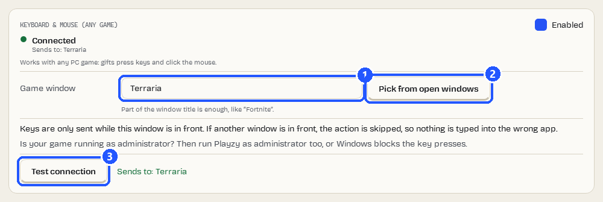

1. **Game window:** part of your game's window title is enough, like `Terraria` or `Fortnite`.
2. **Pick from open windows** lists the windows that are open now. Start your game first, then pick it.
3. **Test connection** shows where keys will go.

**Keys are only sent while that window is in front.** If you alt-tab to your browser or Discord, the action is skipped, so a gift can never type into the wrong app. The Actions list then says *the game window (…) is not in front*. If you leave **Game window** empty, keys go to whatever window is in front, so set it.

**Is your game running as administrator?** Then run Playzy as administrator too. Windows blocks key presses from a normal program to a program running as administrator.

What a keyboard rule looks like (from the **Any game (keyboard)** preset: Finger Heart makes you run forward):

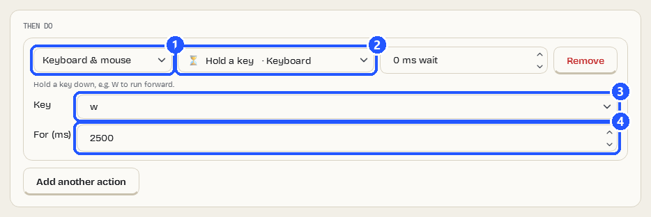

1. The game: **Keyboard & mouse**.
2. The action: **Hold a key**. The others are **Press a key**, **Key combo** (like `ctrl+shift+r`), **Type text**, **Mouse click**, **Mouse move** (turns the camera) and **Mouse wheel**.
3. **Key:** pick from the list or type one, like `w`, `space`, `ctrl` or `f5`.
4. **For (ms):** how long to hold it. 2500 ms is 2.5 seconds.

## 8. Webhook

A rule can call a web address when something happens on your LIVE. Use it for tools that have their own web API: Streamer.bot, smart lights, other mods, or your own server.

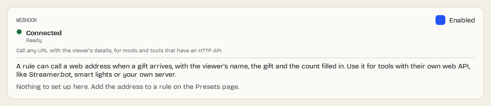

There is nothing to set up on the Games page. You add the address to a rule (see [section 12](#12-rules)):

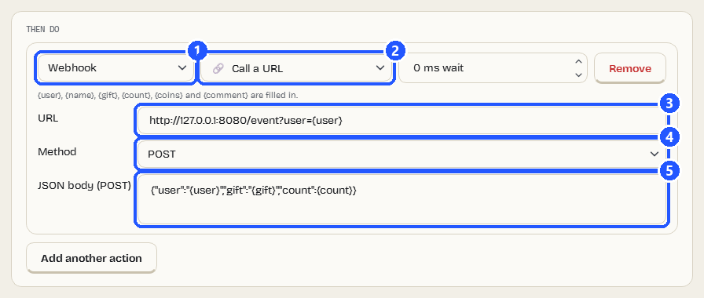

1. The game: **Webhook**.
2. The action: **Call a URL**.
3. **URL:** the address to call. It must start with `http://` or `https://`.
4. **Method:** **GET** or **POST**.
5. **JSON body (POST):** what is sent with a POST.

In the URL and the body, `{user}`, `{name}`, `{gift}`, `{count}`, `{coins}` and `{comment}` are filled in with the viewer's details. Playzy waits up to 6 seconds for an answer. The address only gets called when a rule runs, and only the address you typed.

## 9. Mod SDK

Mods made for Playzy connect to it by themselves. Each mod tells Playzy which actions it has, and they show up in the rule editor as their own game.

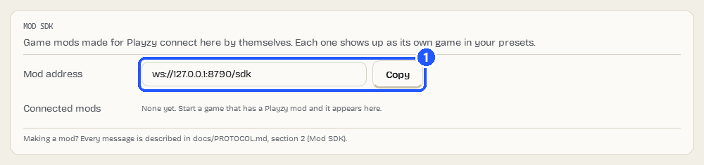

1. **Mod address:** `ws://127.0.0.1:8790/sdk`. **Copy** copies it. It uses the overlay's port, so if you change that port in Settings, this address changes too, and a mod may need to be told the new one.

**Connected mods** lists the mods that are running now. If a mod disconnects, gifts for it wait for it to come back, like they do for a closed game.

Making a mod? Every message is described in `docs/PROTOCOL.md`, section 2, in Playzy's source code.

---

# Part 3. Put it on your stream

## 10. Add the overlay to TikTok LIVE Studio or OBS

The overlay is a web page that Playzy serves on your own PC. It shows:
- the **gift menu**: what each gift does,
- **alerts** when a gift arrives, with the combo count,
- the **gift spinner** wheel,
- the **event feed**: recent gifts, follows and chat,
- the **like goal**: progress to the next like reward,
- the **game HUD**: challenge, health, wins and losses,
- **top gifters**: who sent the most coins.

### Pick the canvas and copy the link

Open **Overlay**.

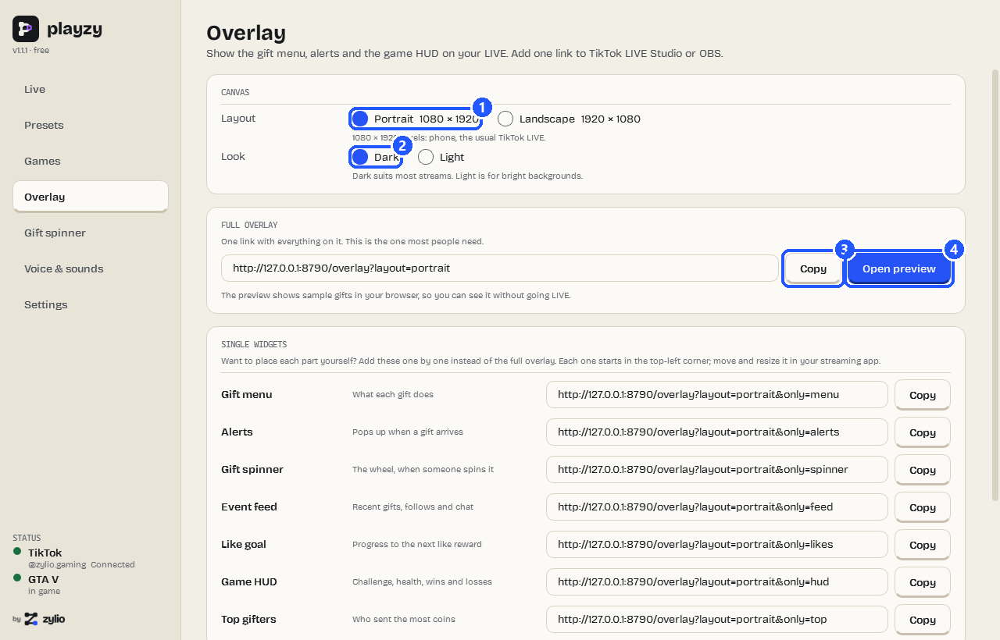

1. **Layout:** **Portrait 1080 × 1920** is the usual TikTok LIVE, for phone viewers. Pick it unless you stream wide.
2. **Look:** **Dark** suits most streams. **Light** is for bright game backgrounds.
3. **Copy** copies the full overlay link, for example `http://127.0.0.1:8790/overlay?layout=portrait`.
4. **Open preview** opens the overlay in your browser with sample gifts, so you can see it without going LIVE.

If you stream wide, pick **Landscape**:

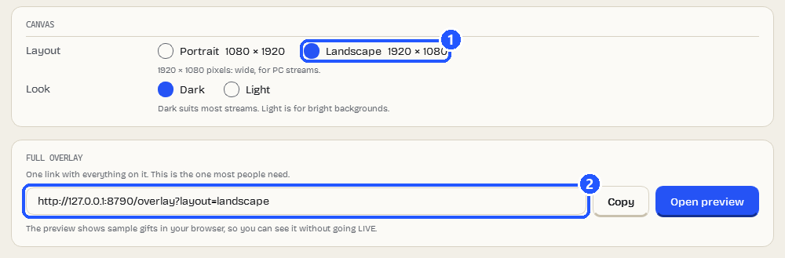

1. **Landscape 1920 × 1080**, for PC-style streams.
2. The link changes to `layout=landscape`. **Copy it again** after you change the layout or the look.

### TikTok LIVE Studio

1. In LIVE Studio, press **Add source**, then choose **Link**.
2. Paste the full overlay link.
3. Set the width and height to the same size as your canvas: **1080 × 1920** for portrait, **1920 × 1080** for landscape.
4. Put it on top of your game, so it is the first source in the list.

### OBS Studio

1. In **Sources**, press **+**, then choose **Browser**.
2. Paste the full overlay link into **URL**.
3. Set **Width** and **Height** to your canvas size, then press **OK**.
4. Move it to the top of the Sources list, above your game.

The Overlay page shows these same steps, with your canvas size filled in:

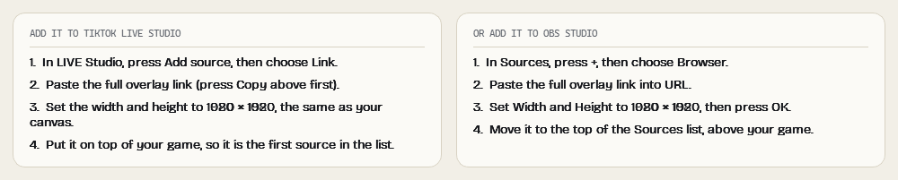

> The overlay only answers your own PC. Run Playzy on the same PC as LIVE Studio or OBS, and keep it open while you stream.

### Portrait and landscape

This is what the overlay looks like in each layout, from **Open preview** with sample gifts over a drawn game:

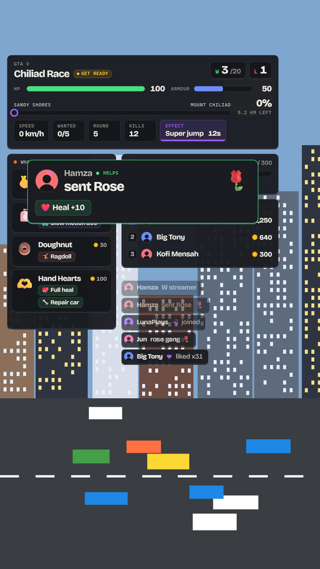

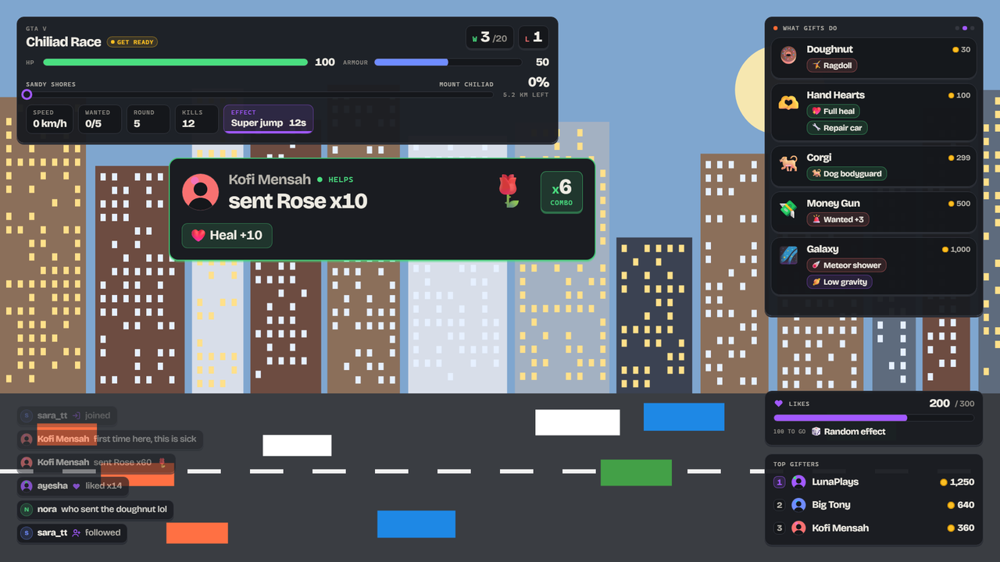

### Single widgets

Want to place each part yourself? Add the widgets one by one instead of the full overlay.

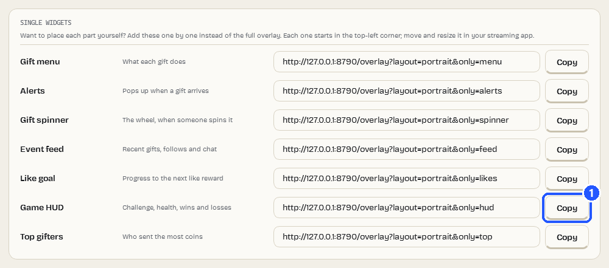

Each line is one widget with its own link. For example, click **Copy** next to **Game HUD** (1) and add it as its own Link or Browser source. Each widget starts in the top-left corner; move and resize it in LIVE Studio or OBS.

Two things you can add to the end of any overlay link:
- `&scale=1.5` makes it bigger (from `0.5` to `2`).
- `&accent=%23ff5a1f` changes the accent colour (`%23` stands for `#`).

---

# Part 4. Decide what viewers can do

## 11. Presets

A **preset** is your list of rules: when a viewer does something, what happens in the game. Make one per game, or one per stream idea. Only one preset is in use at a time.

Open **Presets**.

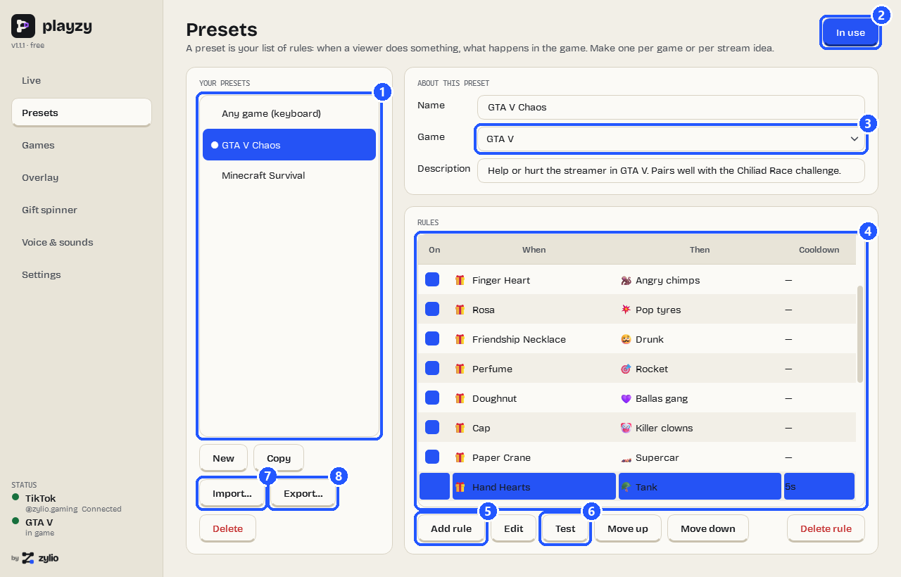

1. **Your presets.** The dot marks the one in use. **New** makes an empty one, **Copy** copies the selected one, and **Delete** removes it (not the one in use).
2. **Use this preset** puts the selected preset in use. It says **In use** when it already is.
3. **Game:** GTA V, Minecraft or Any game. It sets which actions a new rule starts with, whether the Live page shows the GTA V controls, and which game the sidebar status follows.
4. **Rules.** Each row is one rule: **On** (untick to switch it off without deleting it), **When**, **Then**, and its **Cooldown**. Double-click a row to edit it.
5. **Add rule** opens the rule editor ([section 12](#12-rules)). **Edit**, **Move up**, **Move down** and **Delete rule** work on the selected row.
6. **Test** runs the selected rule's actions right now, as if a viewer had sent the gift.
7. **Import…** loads a preset file someone sent you. If some of its rules don't work, Playzy skips them and says which.
8. **Export…** saves the selected preset as a `.json` file, to keep or to share.

Changes save by themselves.

### What the GTA V Chaos preset does

| When | Then |
|---|---|
| Rose | Speed boost |
| TikTok | Heal |
| GG | Ragdoll |
| Ice Cream Cone | Repair |
| Finger Heart | Angry chimps |
| Rosa | Pop tyres |
| Friendship Necklace | Drunk |
| Perfume | Rocket |
| Doughnut | Ballas gang |
| Cap | Killer clowns |
| Paper Crane | Supercar |
| Hand Hearts | Tank (5 s cooldown) |
| Confetti | Airstrike |
| Sunglasses | Skydive (10 s cooldown) |
| Corgi | Fighter jet |
| Money Gun | Meteor shower (10 s cooldown) |
| Swan | Back to airport (20 s cooldown) |
| Galaxy | Black hole (15 s cooldown) |
| Every 300 likes | Speed boost |
| Follow | Heal |
| Share | Launch |
| `!spin` in chat | Spin the wheel (20 s cooldown, 120 s per viewer) |

Gift names are TikTok's English names. If your region uses other names, change them in the rules.

## 12. Rules

Every rule is "**when** this happens, **then** do these actions". Click **Add rule**, or double-click a rule, to open the editor.

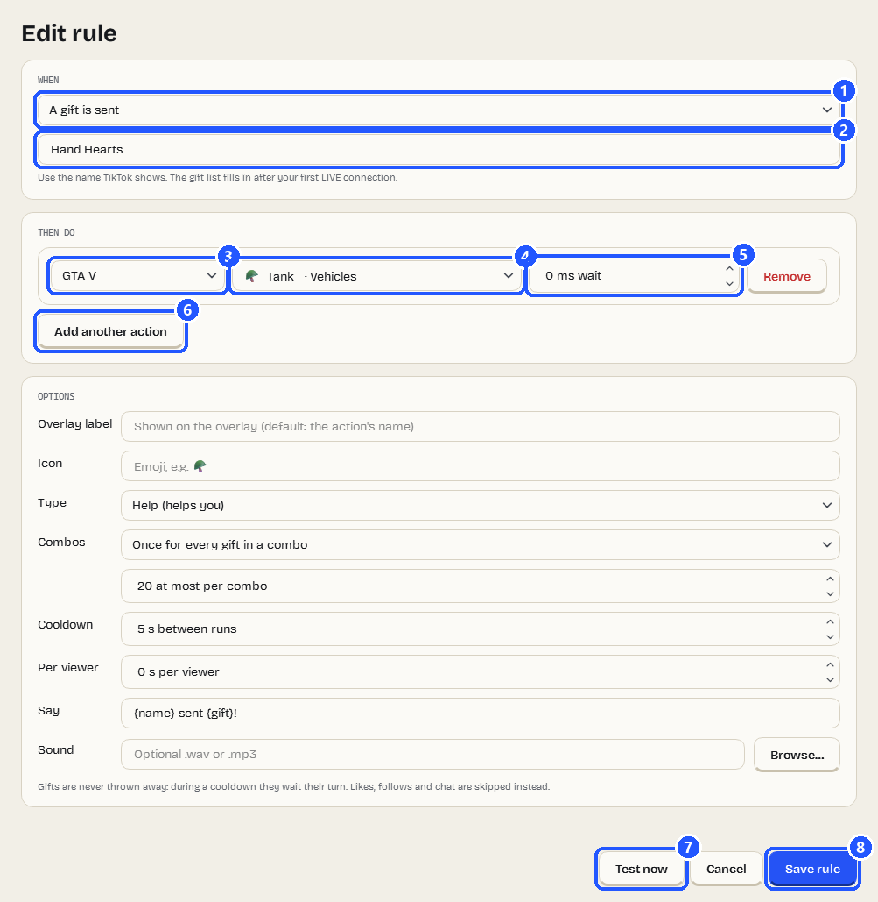

1. **When:** what starts the rule. The seven kinds are below.
2. For a gift: **the gift's name**, as TikTok shows it. After your first LIVE connection, Playzy suggests names as you type.
3. **Then do:** the game, for example **GTA V**. **Playzy** has its own actions: **Spin the wheel**, **Say something**, **Play a sound** and **Overlay message only**.
4. The **action**, here **Tank**. Some actions have more settings under them (how many, which key, which mob).
5. **ms wait:** how long to wait before this action, after the one above. 1000 ms is one second.
6. **Add another action** adds a second step. A rule runs its actions in order. **Remove** takes one out.
7. **Test now** runs these actions once, right now.
8. **Save rule.**

### The seven kinds of trigger

| When | What it means |
|---|---|
| **A gift is sent** | A gift with this name. |
| **Any gift worth at least…** | Any gift of that many coins or more, for gifts that have no rule of their own. If you make several of these tiers, the highest one a gift reaches wins. |
| **Likes reach a number** | Every N likes, counting likes from everyone together. |
| **Someone follows** | Each viewer once per session. |
| **Someone shares the LIVE** | Each viewer at most once every 30 seconds. |
| **Someone joins** | Each viewer once per session. Good for a welcome line. |
| **A chat command** | The first word of a chat message, like `!spin`. Playzy adds the `!` if you leave it out. |

A **session** lasts until you press **New session** on the Live page, or restart Playzy.

A likes rule:

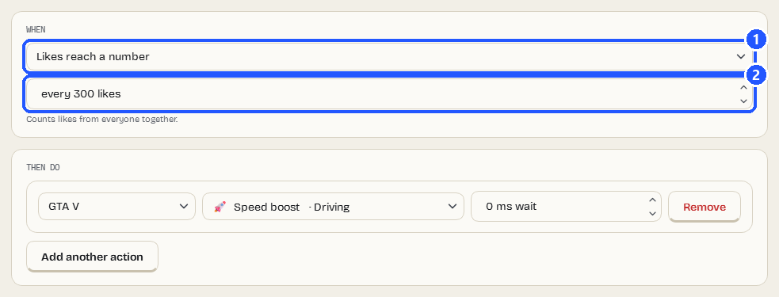

1. **Likes reach a number.**
2. **every 300 likes.** Then a speed boost, in the GTA V Chaos preset.

A coin tier, for every gift you didn't name:

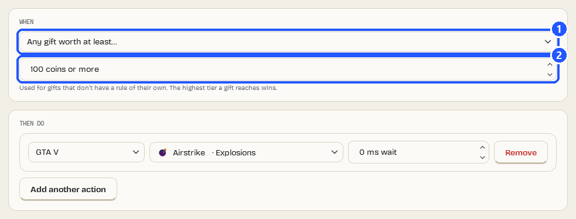

1. **Any gift worth at least…**
2. **100 coins or more.** Here, any gift of 100 coins or more that has no rule of its own calls an airstrike.

A chat command:

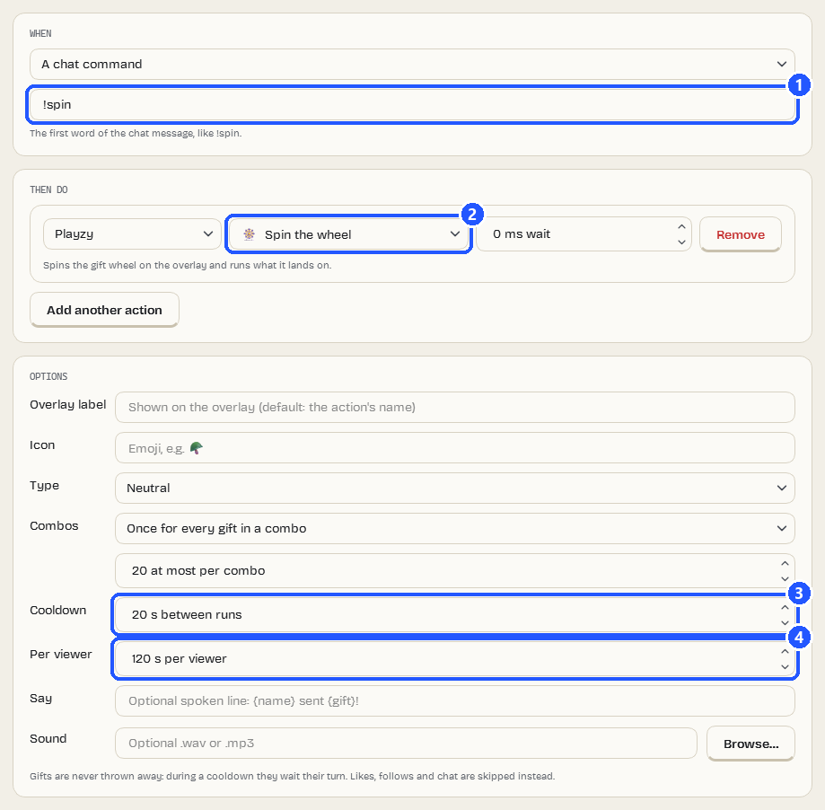

1. The command, **!spin**.
2. The action, **Spin the wheel** ([section 13](#13-the-gift-spinner)).
3. **Cooldown 20 s:** after a spin, nobody can start another one for 20 seconds.
4. **Per viewer 120 s:** each viewer can start one spin every 2 minutes.

### Options

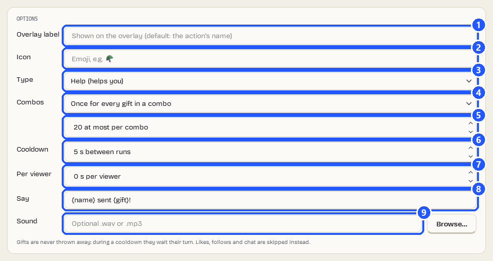

1. **Overlay label:** the name the overlay shows for this rule. Empty means the action's name.
2. **Icon:** an emoji for the overlay. Empty means the action's own icon.
3. **Type:** **Chaos** (hurts you), **Help** (helps you) or **Neutral**. The overlay colours the alert and the gift menu by it.
4. **Combos:** in a combo (Rose x10), **Once for every gift in a combo** runs the rule ten times. **Once per combo** runs it once.
5. **At most per combo:** a limit, so a 500x combo doesn't queue 500 tanks. 20 by default.
6. **Cooldown:** seconds between two runs of this rule.
7. **Per viewer:** seconds before the same viewer can start this rule again.
8. **Say:** a line Playzy speaks when the rule runs, like `{name} sent {gift}!`. It needs **Speak out loud** on the Voice page ([section 14](#14-voice-and-sounds)).
9. **Sound:** a `.wav`, `.mp3` or `.ogg` file to play. **Browse…** picks one.

In **Say** and in text actions, `{name}` is the viewer's name, `{user}` their @ name, `{gift}` the gift, `{count}` how many and `{coins}` the coins.

### Gifts are never lost. Free events are.

Viewers pay for gifts, so Playzy never throws a gift away:
- If the rule is cooling down, the gift **waits its turn** and runs when the cooldown ends.
- If the game is closed for a moment (a loading screen, a crash), gifts **wait up to 10 minutes** for it to come back.

One limit: a gift that has waited 10 minutes in total is dropped. With a long cooldown on a gift people send a lot, that can happen, so keep cooldowns short on cheap gifts.

Likes, follows, shares, joins and chat are free, so they work the other way:
- During a cooldown, they are **skipped**. A like storm can't bury the game.
- If the game isn't connected, they are skipped too.

The Actions list on the Live page shows every action, and why one was skipped.

## 13. The gift spinner

Viewers spin a wheel on your overlay, and the game does whatever it lands on. Every preset has its own wheel.

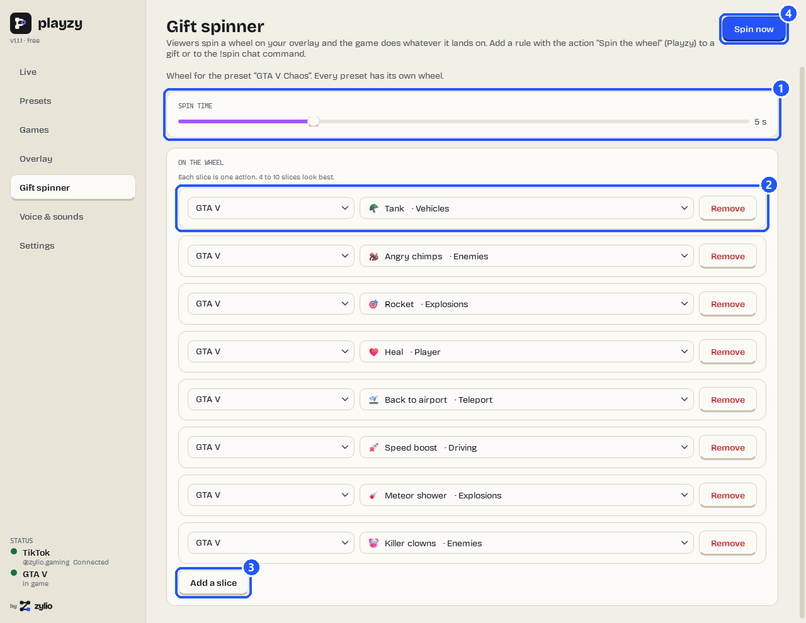

1. **Spin time:** how long the wheel turns, from 2 to 15 seconds.
2. **Each slice is one action.** Pick the game and the action, the same way as in a rule. 4 to 10 slices look best. **Remove** takes a slice off.
3. **Add a slice.**
4. **Spin now** spins it yourself, to see it on the overlay.

To let viewers spin it, a rule needs the action **Spin the wheel** (in the game list, pick **Playzy**). Every default preset already has `!spin` in chat, and you can also give it to a gift. The action the wheel lands on counts like a gift: it waits its turn and is never thrown away.

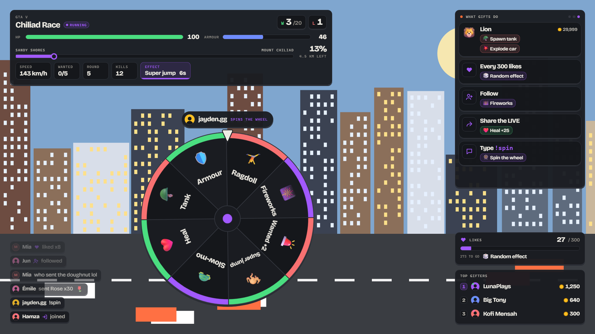

## 14. Voice and sounds

Playzy can read lines and chat out loud with the voices Windows already has. Open **Voice & sounds**.

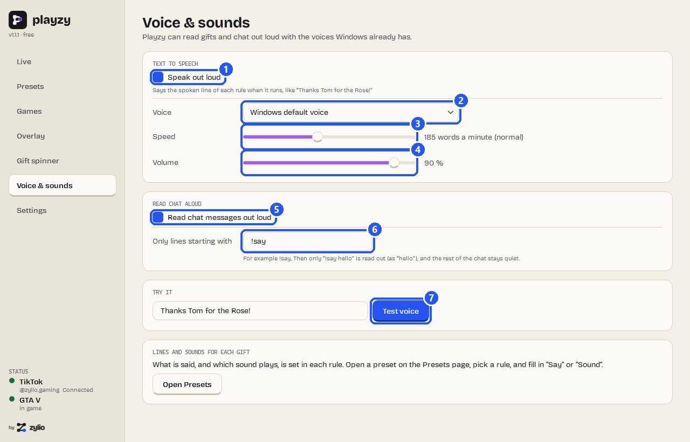

1. **Speak out loud** turns text to speech on. Then each rule's **Say** line is spoken when the rule runs.
2. **Voice:** the voices on your PC. To get more, add one in Windows **Settings > Time & language > Speech**.
3. **Speed:** from 100 to 300 words a minute. 185 is normal.
4. **Volume.**
5. **Read chat messages out loud** reads chat as "*name* says *message*". Links are read as "a link".
6. **Only lines starting with:** for example `!say`. Then only `!say hello` is read out (as "hello"), and the rest of the chat stays quiet. Empty reads every message.
7. **Test voice** speaks the line next to it.

Playzy keeps only a few lines waiting. When chat is fast, it skips lines instead of talking for ten minutes.

The voice and the sounds play on your PC's speakers. Viewers hear them only if your streaming app captures your PC's sound.

**Sounds** are set in each rule (the **Sound** option), or with the Playzy action **Play a sound**.

---

# Part 5. Go live

## 15. Try everything in Test mode

Test mode sends fake viewers through your preset: gifts from your rules, likes, follows, shares, joins and chat with your commands. They go through exactly the same path as real viewers, so what works in Test mode works on stream.

Go to the **Live** page and click **Test mode**.

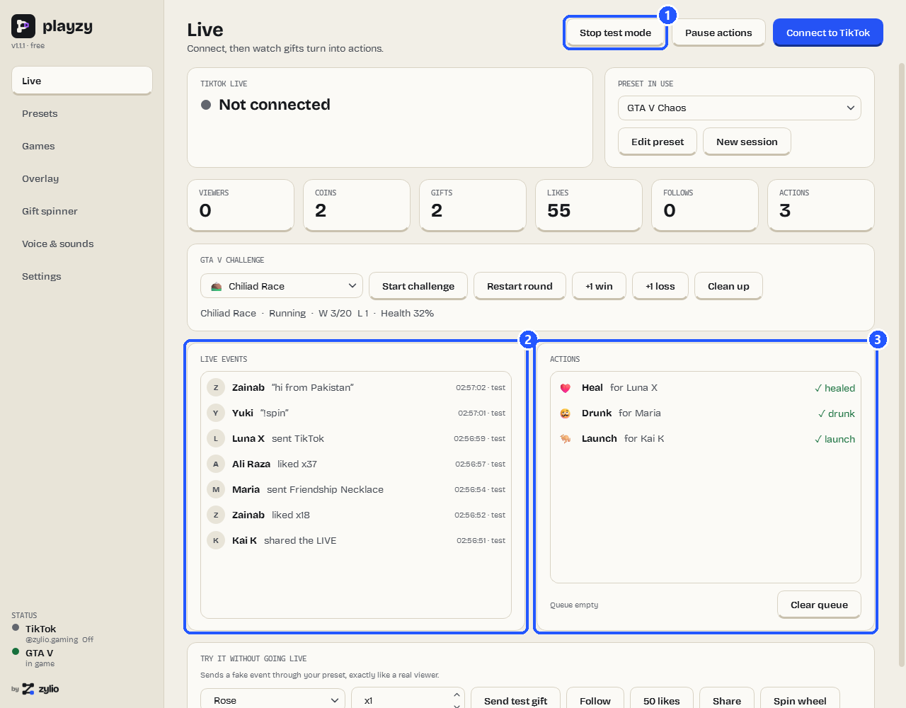

1. The button now says **Stop test mode**. Click it to stop.
2. **Live events** shows the fake viewers. Their lines end with **· test**.
3. **Actions** shows what ran in your game, with a ✓ when it worked and a ✗ with the reason when it didn't.

> Test mode really runs the actions in your game, and the overlay shows the test gifts. Turn it off before you go live, or viewers will see them too.

For one event at a time, scroll down to **Try it without going live**:

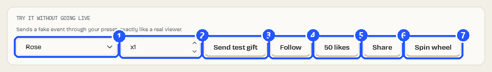

1. Pick a **gift** from your preset, or type any name.
2. **How many** (x1 to x100).
3. **Send test gift.**
4. **Follow** sends one fake follow.
5. **50 likes** sends 50 likes.
6. **Share** sends one share.
7. **Spin wheel** spins the gift spinner.

## 16. Go live

The order that works:

1. **Start your game.** For GTA V, wait for "Playzy is ready" in the game.
2. **Open Playzy.** Check the sidebar: the game line should be green. If **Connect by itself** is on, Playzy starts waiting for your LIVE.
3. **Open TikTok LIVE Studio** (or OBS) with the overlay added, and **go LIVE**.
4. The Live page says **LIVE @your_name** once Playzy has connected. If you turned off Connect by itself, click **Connect to TikTok**.

If Playzy has been waiting a long time, it only looks every few minutes. To connect right away, click **Disconnect**, then **Connect to TikTok**. Don't do that over and over: the free signing service then makes you wait ([section 4](#why-there-is-a-sign-api-key)).

When you end the LIVE, Playzy says the LIVE ended and waits for the next one.

## 17. The Live page while you stream

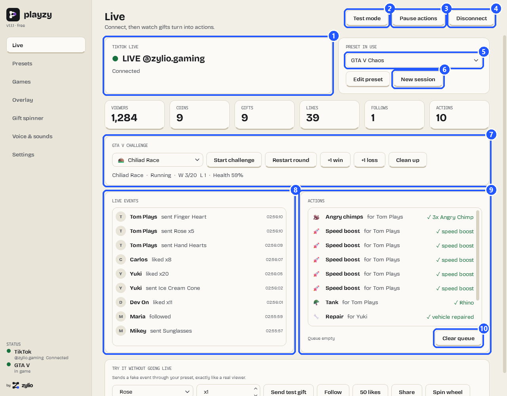

1. **TikTok LIVE:** **LIVE @your_name** when connected. Other states are **Connecting…**, **Waiting for your LIVE** and **Can't connect**, with the reason under it.
2. **Test mode** ([section 15](#15-try-everything-in-test-mode)).
3. **Pause actions** holds every action in the queue. Click **Resume actions** to let them run. Gifts keep waiting (up to 10 minutes). Likes, follows and chat that waited more than 20 seconds are dropped when you resume. Playzy remembers the pause after a restart.
4. **Disconnect** stops reading your LIVE. It says **Connect to TikTok** when you are not connected.
5. **Preset in use:** switch presets at any time, even while live. **Edit preset** opens it.
6. **New session** starts counting from zero: the numbers, the like goals, the top gifters, and who has already followed or joined.
7. **GTA V challenge:** only for GTA V presets ([section 18](#18-gta-v-challenges)).
8. **Live events:** gifts, likes, follows, shares and chat, newest at the top. A combo stays on one line and counts up.
9. **Actions:** every action Playzy ran, for whom, and the result.
10. **Clear queue** throws away everything that is waiting, gifts too. Next to it you see how many actions are waiting.

The numbers across the middle are **Viewers**, **Coins**, **Gifts**, **Likes**, **Follows** and **Actions** for this session.

## 18. GTA V challenges

Besides free play, the Playzy script has 20 challenges. Viewers help or hurt you while you try to win, and the overlay keeps the score: **W** for wins, **L** for losses. In three of them, viewers can even join the game from the chat. The **GTA V challenge** card on the Live page is there when the preset in use is a GTA V preset.

The pictures in this section were made with Playzy 1.1, so the list in them shows 16 challenges, and the card has no **Free play** button yet.

### Step 1: Pick a challenge

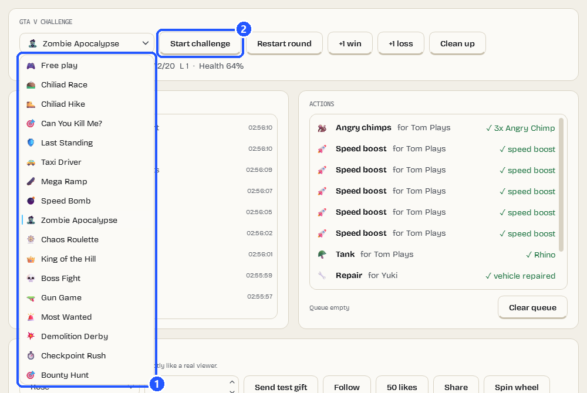

1. Open the list and pick a challenge. **Free play** is no challenge: effects only, no score.
2. Click **Start challenge**. The game takes you to the start, gives you what the challenge needs (a car, weapons), counts down 3-2-1, and you go.

### Step 2: Play it

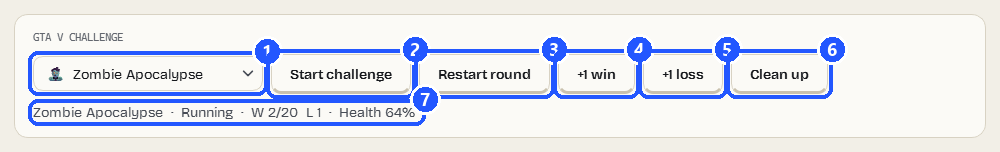

1. The challenge you picked.
2. **Start challenge** again starts it from the beginning.
3. **Restart round** starts the round again, in the same challenge.
4. **+1 win** adds a win by hand.
5. **+1 loss** adds a loss by hand.
6. **Clean up** removes everything viewers spawned.
7. The line under the buttons: the challenge, the round's state, the score (wins out of the goal of 20), and your health.

Next to **Start challenge** there is also a **Free play** button. It stops the challenge and takes you back to free play.

**Start challenge**, **Free play**, **Restart round** and **Clean up** happen right away. They don't wait behind the gifts in the queue, and they work even when **Pause actions** is on.

While a challenge sets up and counts down, you are frozen in place. Gifts that arrive then wait, and run as soon as the round starts.

You can also start one with the hotkeys: in `PlayzyGTA.ini`, a key set to `!mode:zombies` (or any other name from the list in [the settings](#change-the-challenges-in-playzygtaini)) switches to it.

### Or let a gift start one

Viewers can pick the challenge too. Make a rule for a gift (or a chat command) with the action **Start a challenge**:

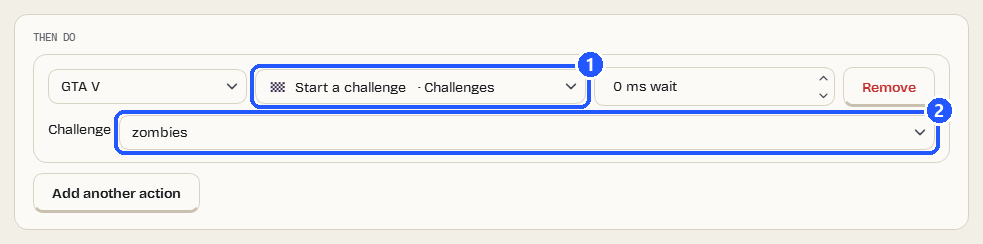

1. The action: **Start a challenge** (game **GTA V**).
2. **Challenge:** which one. The list uses the short names: `chiliad`, `hiking`, `killme`, `laststand`, `taxi`, `megaramp`, `speedbomb`, `zombies`, `roulette`, `koth`, `boss`, `gungame`, `mostwanted`, `derby`, `rush`, `bounty`, `royale`, `spleef`, `racers`, `teamwar`, or `free` for free play.

### How winning and losing works

- In every challenge, **you lose the round if you die or get busted.** Each challenge adds its own ways to win or lose, below.
- After a win or a loss, the result shows for 5 seconds and the next round starts by itself.
- The score is saved in the game's `scripts` folder, so it is still there after a restart.
- Switching to another challenge resets W and L to zero.
- During a challenge the police stay away (except in **Most Wanted**), but a viewer's **5 stars** gift still brings them.
- An enemy you knock down counts as killed and stays down.
- In the fighting challenges (Can You Kill Me?, Last Standing, Zombie Apocalypse, King of the Hill, Boss Fight, Gun Game, Battle Royale, Team War), an enemy that gets stuck or wanders off is brought back near you.
- Each challenge only takes the gifts that fit it ([below](#which-gifts-work-in-each-challenge)).

### The 20 challenges

**Chiliad Race.** Start at the airport and get to the top of Mount Chiliad. On foot unless you set a `StartVehicle`.
- Win: you reach the summit.

**Chiliad Hike.** The same climb from the trail start, on foot only. The game pulls you out of any vehicle.
- Win: you reach the summit.

**Can You Kill Me?** Survive while viewers send enemies.
- Win: you are still alive after 5 minutes.

**Last Standing.** Waves of enemies that get harder: Ballas, then killer clowns, then SWAT, with zombies and juggernauts on some waves. You get some health and armour back between waves. Only the wave's own enemies count: when they are all down, the next wave comes. Enemies that viewers send still fight you, but the HUD counts them apart (*from viewers*), and they don't hold the next wave back. An enemy stuck on a roof or too far away is brought back near you.
- Win: you clear all 10 waves.

**Taxi Driver.** Pick up passengers and drive them to their stop. Each fare has a time limit; if you are too slow, the passenger walks off and you get no fare.
- Win: you deliver 10 passengers.

**Mega Ramp.** A giant ramp built in the desert, and a fast car.
- Win: you land 150 m past the end of the ramp.
- Lose: you land short, bail out of the car, fall off the side, or haven't jumped after 90 seconds.

**Speed Bomb.** A bus with a bomb on it. The bomb arms once you reach 60 km/h.
- Win: you keep the bus above 50 km/h for 3 minutes.
- Lose: you drop below 50 km/h for more than 3 seconds, leave the bus, or wreck it.

**Zombie Apocalypse.** Sandy Shores at night, in fog, with the power out and no traffic. You start with a bat, a shotgun and a pistol. The clock runs from 22:00 to dawn over 6 minutes, and zombies come in bigger groups as the night goes on. A zombie's bite infects you: the infection drains your health, and at 100% you turn.
- Win: you survive until dawn.
- Lose: your infection reaches 100%.
- Viewers: **Heal** cures the infection completely. **Supply drop** gives weapons and takes 40% off the infection. **Zombie horde** sends 8 fast runners. **Zombies** sends 5 more.

**Chaos Roulette.** Drive a Sultan from the airport to the Vinewood sign. Every 40 seconds a wheel spins on your overlay, and when it stops, its rule starts in the game. Timed rules last 20 to 30 seconds: no brakes, ice roads, super jump, explosive punches, explosive bullets, slow motion, an invisible car, moon gravity. The others happen once: rocket rain, two chaser cars, a turbo, or drunk driving. Rules stack.
- Win: you reach the Vinewood sign.
- Viewers: **Spin the roulette** adds an extra spin (up to 5 can wait).

**King of the Hill.** Stand inside the zone (a circle marked on the ground, 10 m from its centre to the edge) while waves of three enemies attack every 12 seconds. Every 45 seconds the zone moves somewhere nearby. Your time inside adds up; leaving it doesn't reset it.
- Win: you have spent 120 seconds inside the zone.

**Boss Fight.** One boss: a juggernaut with a minigun, 4000 health and armour, and a health bar on the overlay. At two thirds of its health it takes a rocket launcher and calls 4 SWAT; at one third it switches back to the minigun, aims better, moves faster and calls 6 more. Two more SWAT come every 25 seconds.
- Win: the boss dies.
- Viewers: **Heal the boss** gives it a sixth of its health back. **Boss rage** makes it faster and more accurate for 15 seconds.

**Gun Game.** You climb 12 weapons: Pistol, Pistol .50, Micro SMG, SMG, Pump shotgun, Assault shotgun, Assault rifle, Carbine, MG, Combat MG, Grenade launcher, Knife. Every kill you make moves you up one. Ammo is endless, and there are always about six enemies around.
- Win: you get a kill with the knife.
- Viewers: **Weapon up** (or **Weapons**) moves you up one. **Weapon down** moves you down one.

**Most Wanted.** Five stars and real police, starting in a Sultan. Lose your stars and they come straight back.
- Win: you survive 4 minutes.
- Viewers: **Clear wanted** drops you to 2 stars for 20 seconds. **5 stars** brings the stars back at once and sends a SWAT team.

**Demolition Derby.** You in a strong car on the airport apron, and 6 AI cars that ram you.
- Win: you are the last car driving.
- Lose: your car is wrecked, or you are out of it for more than 5 seconds.
- Viewers: **Rammer car** sends one more.

**Checkpoint Rush.** 8 checkpoints chained across the city, each 300 to 600 m from the last. You start with 60 seconds, and every checkpoint adds 20. The next checkpoint after the current one shows smaller, so you can plan.
- Win: you reach the last checkpoint.
- Lose: the time runs out.
- Viewers: **Add time** gives 15 seconds. **Steal time** takes 10 (it never leaves you less than 3).

**Bounty Hunt.** A target drives around the city in a Baller with three armed bodyguards. You start with weapons and a car, and see only a red search area on the map, which moves every 10 seconds. Within 120 m you see exactly where the target is, and the bodyguards attack.
- Win: the target dies within 5 minutes.
- Lose: the 5 minutes run out.
- Viewers: **Reveal the target** shows exactly where it is for 15 seconds. **Armour the target** gives it armour and more health.

**Battle Royale.** You start in the middle of a circle (the zone) with weapons, and 12 AI fighters hunt you. Over 5 minutes the zone gets smaller in 5 steps: at first its edge is 220 m from the centre, at the end 15 m. Each step it holds for a while, then closes. Outside the zone you lose health every second, a little more at each step, and *GET IN THE ZONE* flashes on the screen. Fighters who end up outside are brought back in, so the end is always a fight inside the circle.
- Win: every fighter in the round is down: the 12 AI fighters and every viewer who joined.
- Lose: the zone takes your last health.
- Viewers: type **!join** in the chat to drop in as a fighter, with their name over their head (up to 8 viewers a round). Gifts made for a fight work as usual. **Ballas gang** sends 3 more fighters near you, with the viewer's name; those 3 fight, but you don't need to take them down to win. Other help gifts become a **Supply drop**, other chaos gifts become **Ballas gang**.

**Sky Spleef.** You stand on a floor of tiles 250 m above the sea, with no parachute. A tile that is about to fall flashes red, then drops 1.5 seconds later. One tile also falls by itself every 15 seconds.
- Win: you are still up there after 3 minutes.
- Lose: you fall through.
- Viewers: chaos gifts make tiles near you fall: **Steal time** drops 4, **Rocket** 3, and **Ragdoll**, **Drunk** and **Low gravity** 2 each (with their normal effect too). Help gifts put tiles back: **Add time** brings back 4, and **Heal** and **Invincible 15 s** bring back 2 (and heal you or make you invincible). Enemies and vehicles don't fit up there; they become **Add time** or **Steal time**.
- When the round is lost, or you leave the challenge while up there, you get a parachute for the way down.

**Viewer Racers.** A race from the airport to the Vinewood sign against AI cars. Before the start, the cars wait on the grid for 15 seconds while viewers join. If fewer than 4 cars are on the grid, crowd racers fill it, so the race always works. Up to 8 cars race with you. Each car shows its racer's name over it, on the map and on the number plate. A car that gets stuck is put back on the road after 8 seconds.
- Win: you reach the finish first.
- Lose: another car reaches the finish first.
- Viewers: type **!join** to get a car. After the start, a viewer who joins takes over a crowd car. A gift from a viewer who has a car boosts their own car (on the grid, the boost waits for the start). Other drive gifts work as usual, and the rest become **Speed boost** (help) or **Rammer car** (chaos).

**Team War.** Two sides. Blue fights with you, red fights against you. The round starts with bots on both sides, 3 blue and 6 red, so it works without anyone in the chat. Red comes from its own side of the arena.
- Win: all of red is down.
- Viewers: type **!red** or **!blue** to join that side, or **!join** for the smaller team (up to 12 viewers a round). Each viewer's fighter carries their name. After that, a gift from a viewer on a side sends that side 2 more fighters. A gift from someone who didn't pick a side works as usual; help gifts that don't fit become **Bodyguards** (2 blue fighters), chaos gifts become **Ballas gang** (2 red fighters).

> The Mega Ramp is built from GTA's stunt-race props. If your game doesn't load them in Story Mode, the challenge says so and goes back to free play. If any challenge can't start, the game says why and goes back to free play.

### Viewers join from the chat

In **Battle Royale**, **Viewer Racers** and **Team War**, viewers join the game by typing in the chat:

| Viewer types | Battle Royale | Viewer Racers | Team War |
|---|---|---|---|
| **!join** | drops in as a fighter | gets a car | joins the smaller team |
| **!red** | same as !join | same as !join | joins red, against you |
| **!blue** | same as !join | same as !join | joins blue, with you |

- The message must be only that word. The **!** is optional: **join**, **red** and **blue** work too.
- You don't need a rule for this. It works with every preset, as long as the GTA V script is connected and one of these three challenges is running.
- Each viewer can join once per round. The game shows the viewer's name over their fighter or their car.
- The game reminds everyone watching: from time to time it shows *type !join* (or *!red or !blue*) on the screen and in its status line at the top.

There are also three actions for rules: **Join the challenge**, **Join the red team** and **Join the blue team**. They do the same for the viewer who sent the gift. In the other challenges and in free play they do nothing.

### Gift actions made for the challenges

Fifteen GTA V actions are made for the challenges. In the rule editor they are in the **Challenges** group:

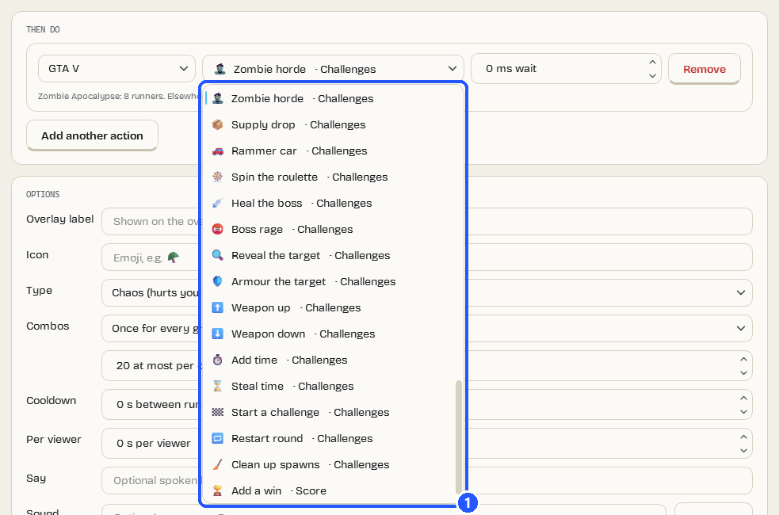

1. The **Challenges** group: the challenge actions, then **Start a challenge**, **Restart round** and **Clean up spawns**. (This picture is from Playzy 1.1. Since 1.2 the three **Join** actions are in the group too.)

Pick one and the editor says what it does in its challenge, and what it does anywhere else:

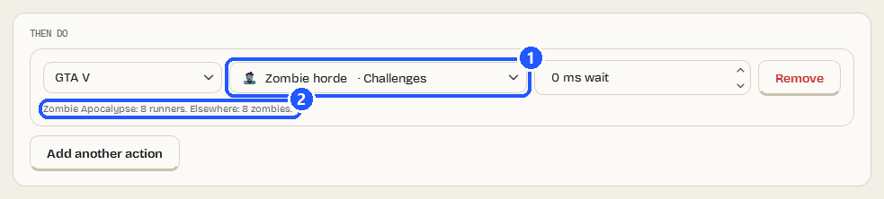

1. The action, here **Zombie horde**.
2. What it does: in Zombie Apocalypse, 8 runners. Elsewhere, 8 zombies.

A challenge action is not wasted outside its own challenge. In free play, and in the challenges where it fits, it does something else instead. In a challenge where it doesn't fit, that challenge's stand-in runs ([next section](#which-gifts-work-in-each-challenge)).

| Action | In its challenge | In free play |
|---|---|---|
| **Zombie horde** | Zombie Apocalypse: 8 fast runners | 8 zombies |
| **Supply drop** | Zombie Apocalypse: weapons, and 40% off the infection | Weapons and a heal |
| **Rammer car** | Demolition Derby: one more rammer | A car hunts you for 45 seconds |
| **Spin the roulette** | Chaos Roulette: an extra spin | A random chaos effect |
| **Heal the boss** | Boss Fight: the boss gets a sixth of its health back | A juggernaut |
| **Boss rage** | Boss Fight: 15 seconds of rage | A juggernaut |
| **Reveal the target** | Bounty Hunt: shows the target for 15 seconds | A heal |
| **Armour the target** | Bounty Hunt: the target gets armour and health | 2 SWAT |
| **Weapon up** | Gun Game: one weapon up | Weapons and armour |
| **Weapon down** | Gun Game: one weapon down | You lose your guns, except a pistol |
| **Add time** | Checkpoint Rush: 15 more seconds. Sky Spleef: 4 tiles come back | Repairs your car |
| **Steal time** | Checkpoint Rush: 10 seconds fewer. Sky Spleef: 4 tiles near you fall | Ragdoll |
| **Join the challenge** | Battle Royale: drops in as a fighter. Viewer Racers: a car. Team War: the smaller team | Nothing |
| **Join the red team** | Team War: joins red. Battle Royale, Viewer Racers: same as Join | Nothing |
| **Join the blue team** | Team War: joins blue. Battle Royale, Viewer Racers: same as Join | Nothing |

Some ordinary effects change in a challenge too: **Heal** cures the infection in Zombie Apocalypse, **Weapons** moves you up in Gun Game, **Clear wanted** and **5 stars** work as described in Most Wanted, and in Sky Spleef several effects also make tiles fall or come back.

The default **GTA V Chaos** preset doesn't use the challenge actions yet. Add rules for the ones you want.

### Which gifts work in each challenge

Each challenge only takes the gifts that fit it. In Last Standing, a gift can send enemies or help you, but it never launches you, sends you skydiving or teleports you away. In the Chiliad Race, no jet or helicopter skips the climb.

A gift that doesn't fit is not lost. The challenge runs its **stand-in** instead: a help stand-in for a gift that helps you, a chaos stand-in for every other gift. The Actions list on the Live page then adds *(instead of …)* with the short name of the gift's own effect, like *(instead of tank)*. In free play every gift runs as it is.

These count as **help** gifts: Tank, Supercar, Monster truck, Fighter jet, Attack heli, Speed boost, Repair, Heal, Invincible 15 s, Weapons, Bodyguards, Clear wanted, Supply drop, Reveal the target, Weapon up, Add time. Every other effect counts as **chaos**.

Many challenges share one of these sets:

- **Fight set** (on foot, against enemies): Heal, Invincible 15 s, Weapons, Bodyguards, Supply drop, Weapon up, One-hit KO, Ragdoll, Drunk, Low gravity, Rocket, Airstrike, Meteor shower, Thunderstorm, Night, Day, Angry chimps, Ballas gang, Killer clowns, Aliens, Zombies, SWAT team, Juggernaut, Zombie horde.
- **Drive set** (at the wheel): Speed boost, Repair, Heal, Invincible 15 s, Pop tyres, Rammer car, Rocket, Airstrike, Drunk, Low gravity, Thunderstorm, Night, Day.
- **Vehicles**: Tank, Supercar, Monster truck, BMX bike, Clown van, Fighter jet, Attack heli. Where the table says *as roadblocks*, these don't give you a vehicle: they land on the road in your way.

| Challenge | Gifts that fit | Help stand-in | Chaos stand-in |
|---|---|---|---|
| Free play | every effect | | |
| Chiliad Race | Drive set, Tank, Supercar, Monster truck, BMX bike, Clown van | Speed boost | Rammer car |
| Chiliad Hike | Heal, Invincible 15 s, Weapons, Bodyguards, Speed boost, Ragdoll, Drunk, Low gravity, Rocket, Airstrike, Thunderstorm, Night, Day, Angry chimps, Ballas gang, Killer clowns, Zombies; Vehicles as roadblocks | Heal | Angry chimps |
| Can You Kill Me? | Fight set, Rammer car | Supply drop | Killer clowns |
| Last Standing | Fight set | Supply drop | Ballas gang |
| Taxi Driver | Drive set; Vehicles as roadblocks | Repair | Rammer car |
| Mega Ramp | Speed boost, Repair, Heal, Low gravity, Drunk, Rocket, Pop tyres, Thunderstorm, Night, Day | Speed boost | Drunk |
| Speed Bomb | Drive set; Vehicles as roadblocks | Repair | Rammer car |
| Zombie Apocalypse | Heal, Supply drop, Invincible 15 s, Weapons, Bodyguards, Weapon up, One-hit KO, Ragdoll, Drunk, Rocket, Zombies, Zombie horde | Supply drop | Zombies |
| Chaos Roulette | Drive set, Spin the roulette; Vehicles as roadblocks | Speed boost | Spin the roulette |
| King of the Hill | Fight set | Supply drop | Ballas gang |
| Boss Fight | Fight set, Heal the boss, Boss rage | Supply drop | Boss rage |
| Gun Game | Heal, Invincible 15 s, Weapons, Weapon up, Weapon down, One-hit KO, Ragdoll, Drunk, Low gravity, Thunderstorm, Night, Day, Angry chimps, Ballas gang, Killer clowns, Aliens, Zombies, SWAT team | Weapon up | Weapon down |
| Most Wanted | Drive set, 5 stars, Clear wanted, Weapons, Bodyguards, SWAT team; Vehicles as roadblocks | Clear wanted | 5 stars |
| Demolition Derby | Drive set; Vehicles as roadblocks | Repair | Rammer car |
| Checkpoint Rush | Drive set, Add time, Steal time; Vehicles as roadblocks | Add time | Steal time |
| Bounty Hunt | Drive set, Tank, Supercar, Monster truck, Weapons, Bodyguards, Reveal the target, Armour the target, SWAT team, Ballas gang | Reveal the target | Armour the target |
| Battle Royale | Fight set | Supply drop | Ballas gang |
| Sky Spleef | Heal, Invincible 15 s, Drunk, Low gravity, Ragdoll, Thunderstorm, Night, Day, Rocket, Add time, Steal time | Add time | Steal time |
| Viewer Racers | Drive set | Speed boost | Rammer car |
| Team War | Fight set | Bodyguards | Ballas gang |

The three **Join** actions are never swapped. In Battle Royale, Viewer Racers and Team War they join the viewer, everywhere else they do nothing.

**Change the lists yourself** in the `[ChallengeEffects]` section of `PlayzyGTA.ini`. Add a line with the challenge's short name and the effects it should take, or `all` for every effect. For example:

```
[ChallengeEffects]
laststand=heal,shield,weapons,ballas,swat,juggernaut,airstrike
killme=all
```

Use the effects' short names. They are in the same order as in [the effects table](#the-56-effects):

| Group | Short names |
|---|---|
| Vehicles | `tank`, `supercar`, `monster`, `jet`, `heli`, `bmx`, `clownvan` |
| Driving | `boost`, `repair`, `removecar`, `poptires`, `flip`, `launch` |
| Player | `heal`, `shield`, `weapons`, `bodyguard`, `clearwanted`, `onehitko`, `ragdoll`, `drunk`, `lowgravity`, `wanted` |
| Teleport | `skydive`, `airport`, `jail`, `randomtp` |
| Explosions | `rocket`, `airstrike`, `meteor`, `blackhole` |
| Enemies | `chimp`, `ballas`, `clown`, `alien`, `zombie`, `swat`, `juggernaut` |
| World | `storm`, `night`, `day` |
| Challenges | `horde`, `supplydrop`, `rammer`, `roulette`, `bossheal`, `bossrage`, `reveal`, `escort`, `upgrade`, `downgrade`, `addtime`, `stealtime`, `join`, `joinred`, `joinblue` |

A name the script doesn't know is skipped and noted in `PlayzyGTA.log`. Save the file and press **Insert** in the game.

### The overlay during a challenge

The game HUD on the overlay changes with the challenge. In Zombie Apocalypse it counts down to dawn and shows your infection:

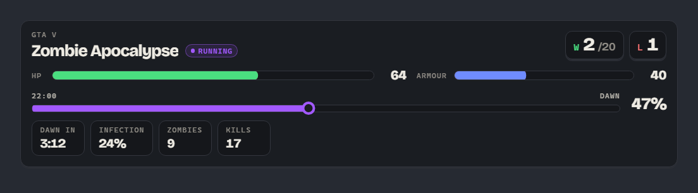

In Boss Fight, the bar is the boss's health:

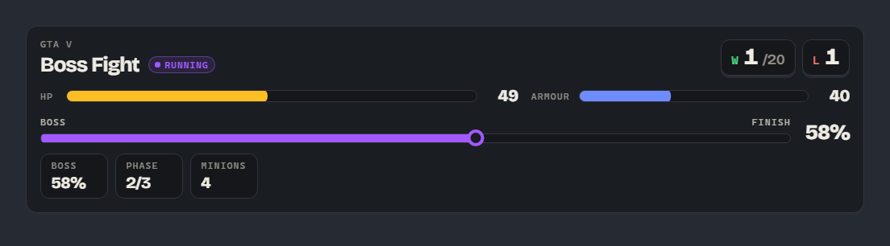

In Chaos Roulette, the game spins the wheel itself. It turns on your overlay for about 4.5 seconds, and the rule starts in the game when it stops. The HUD lists the rules that are running and how long they have left:

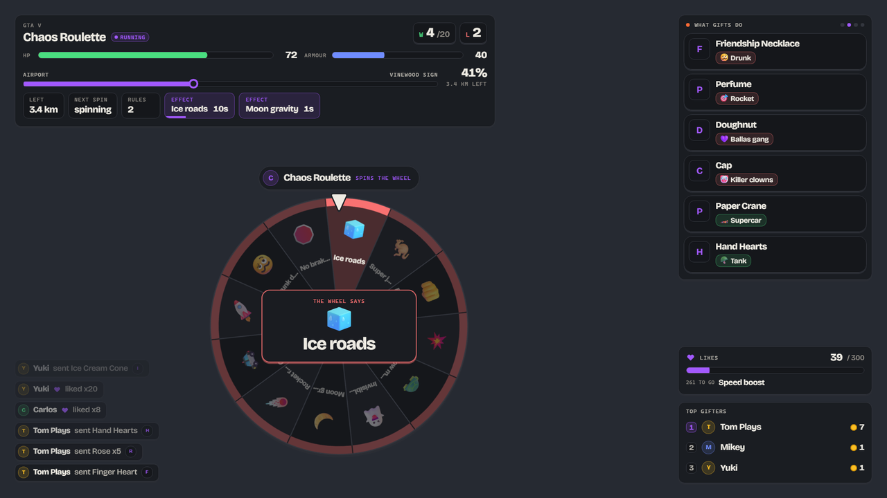

These pictures come from the app with a stand-in game, not from a real round.

### Change the challenges in PlayzyGTA.ini

`PlayzyGTA.ini` is in your GTA V `scripts` folder. After you change it, save it and press **Insert** in the game.

**For all challenges** (`[General]`):

| Setting | Default | What it does |
|---|---|---|
| `WinGoal` | 20 | The goal shown next to your wins. |
| `AutoRestart` | true | Start the next round by itself after a win or a loss. |
| `ResultSeconds` | 5 | How long the result shows. |
| `CountdownSeconds` | 3 | The countdown before each round. |
| `DisableCopsInModes` | true | No police during challenges. |
| `ResetScoreOnModeChange` | true | W and L go back to zero when you switch challenge. |
| `MaxEnemies` | 25 | Most enemies alive at once. |
| `StartMode` | free | The challenge the game starts in. |

**Each challenge** has its own section with its start position (`X`, `Y`, `Z`, `Heading`) and these:

| Section | Settings (default) |
|---|---|
| `[Chiliad]` | `TargetRadius` (25), `StartVehicle` (empty: on foot) |
| `[Hiking]` | `TargetRadius` (25) |
| `[KillMe]` | `Seconds` (300) |
| `[LastStand]` | `Waves` (10) |
| `[Taxi]` | `Goal` (10 fares), `Vehicle` (taxi) |
| `[MegaRamp]` | `Height` (110), `Goal` (150 m), `Vehicle` (t20) |
| `[SpeedBomb]` | `ArmKmh` (60), `MinKmh` (50), `GraceSeconds` (3), `Seconds` (180), `Vehicle` (bus) |
| `[Zombies]` | `Seconds` (360: how long the night lasts) |
| `[Roulette]` | `TargetX/Y/Z` (the Vinewood sign), `SpinEverySeconds` (40), `Vehicle` (sultan) |
| `[Koth]` | `Radius` (10 m), `HoldSeconds` (120) |
| `[Boss]` | `Health` (4000) |
| `[GunGame]` | only the position |
| `[MostWanted]` | `Seconds` (240), `Vehicle` (sultan) |
| `[Derby]` | `Rammers` (6, from 2 to 12), `Vehicle` (dukes2) |
| `[Rush]` | `Checkpoints` (8), `StartSeconds` (60), `BonusSeconds` (20), `Vehicle` (sultan) |
| `[Bounty]` | `Seconds` (300), `Vehicle` (sultan, your car) |
| `[Royale]` | `StartRadius` (220 m), `EndRadius` (15 m), `Stages` (5), `Seconds` (300), `Fighters` (12), `MaxJoins` (8), `DamagePerSecond` (6) |
| `[Spleef]` | `Z` (250: the floor's height), `Seconds` (180), `Tiles` (7 along one side), `CrumbleSeconds` (15, 0 = never), `Prop` (empty: built-in) |
| `[Racers]` | `StartX/Y/Z`, `TargetX/Y/Z`, `TargetRadius` (30), `StartName`, `TargetName`, `Vehicle` (elegy2), `RacerCars` (elegy2, carbonizzare, feltzer2, jester, massacro), `GridSeconds` (15), `MinRacers` (4), `RacerSpeed` (40), `DrivingStyle` (786468) |
| `[TeamWar]` | `RedBots` (6), `BlueBots` (3), `MaxBlue` (8), `MaxJoins` (12) |

`[ChallengeEffects]` decides which gifts each challenge takes ([above](#which-gifts-work-in-each-challenge)).

> **Updating from an older Playzy?** Playzy updates the script by itself, but it keeps your old `PlayzyGTA.ini`. That file keeps working; the new challenges use their built-in settings. To get the new sections, click **Update the Playzy script** on the Games page and choose **Use the defaults**. That resets the whole file, so write down anything you changed first.

When the game isn't running, the line under the challenge buttons says so:

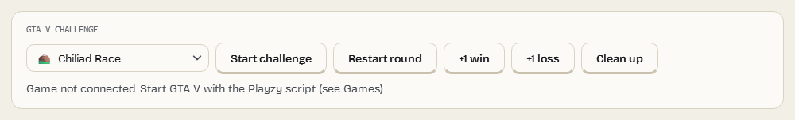

---

# Part 6. Help

## 19. If something goes wrong

### TikTok

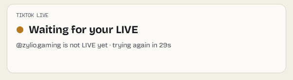

**"@your_name is not LIVE yet"**: Playzy connects to a LIVE that is already running. Go LIVE first. Playzy tries again by itself, and waits a little longer each time (at most 3 minutes). Check that the name in Settings is your own TikTok name.

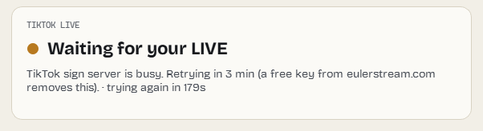

**"TikTok sign server is busy"**: the free signing service limits how often you can connect. Playzy waits 3 minutes and tries again. Don't press Connect and Disconnect over and over. A free key from [eulerstream.com](https://www.eulerstream.com) in **Settings > Sign API key** removes the limit ([section 4](#why-there-is-a-sign-api-key)).

| Problem | What to do |
|---|---|
| **"No TikTok user @…"** | The name is spelled wrong. Use the name from your link, `tiktok.com/@your_name`. Playzy tries again in 5 minutes, or click **Save & connect** after fixing it. |
| **"This LIVE is age-restricted"** | TikTok doesn't share events from age-restricted LIVEs, so Playzy can't read them. |
| **"Connection problem: …"** | A network problem, or TikTok changed something. Playzy keeps trying. If it keeps happening after a TikTok change, the TikTokLive library may need an update, and so will Playzy. |
| **A gift does nothing** | Check the gift name in the rule. It has to match the name TikTok uses in your region. After your first connection, the rule editor suggests the right names. Check the rule is ticked **On**, and that its preset is the one in use. |
| **Gifts arrive late** | The rule has a cooldown, so gifts wait their turn. Look at **Actions** on the Live page, and lower the cooldown if you like. During a GTA V challenge's setup and countdown, gifts also wait until the round starts. |
| **A GTA V gift does something else** | The challenge that is running doesn't take that gift, so it runs the challenge's stand-in. The Actions list says *(instead of …)*. See [which gifts work in each challenge](#which-gifts-work-in-each-challenge). |
| **!join does nothing** | It only works in Battle Royale, Viewer Racers and Team War, with the GTA V script connected. The chat message must be only **!join** (or **!red**, **!blue**). Each viewer can join once per round, and a round can be full (8 fighters in Battle Royale, 8 cars in Viewer Racers, 12 viewers in Team War). |
| **A new challenge says it isn't in the script** | The game still runs an older script. Press **Insert** in GTA V, or click **Update the Playzy script** on the Games page. |

### GTA V: "Game not connected"

Go through this list in order:

1. **Story Mode is loaded.** Not the main menu, not GTA Online.
2. **The Games page shows three green dots** for ScriptHookV, the ASI loader and ScriptHookVDotNet. If one is red, install it ([section 5](#5-gta-v)).
3. **The Playzy script is installed and up to date.** The Games page says *Version … is installed. It's up to date.* The files are `PlayzyGTA.3.cs` and `PlayzyGTA.ini` in `GTA V\scripts`. Playzy updates an older script by itself when it starts. If the game was already running then, the status says *old script … running: press Insert in GTA V to load the new one*: press **Insert** in the game. If the button says **Update the Playzy script**, click it.
4. **No old gift script in the way.** If the Games page names a script that also uses port 8766 (like `GiftEffects.cs`), click **Install and fix** ([section 5](#step-3-let-playzy-install-its-script)).
5. **"Playzy is ready" appears in the game.** If it doesn't, press **Insert** to reload scripts. Then open **`ScriptHookVDotNet.log`** in your GTA V folder, and **`PlayzyGTA.log`** in `GTA V\scripts`. They say what went wrong.
6. **GTA V just updated?** After a game update, ScriptHookV usually stops working until its author releases a new version. Check its page.
7. **The ports.** Leave **Script port** at 8766, the same as `Port=` in `PlayzyGTA.ini`. If 8766 is taken, the script moves to 8767 to 8770, or writes its port into `scripts\PlayzyGTA.port`, and Playzy finds it by itself. Check that the **GTA V folder** on the Games page is the folder you play from, because that is where Playzy looks for that file.
8. Click **Test connection** on the GTA V card. If it found the script on another port, it says which.

### Keys don't work in a game

- Set **Game window** on the Games page, and keep the game in front. The Actions list says *the game window (…) is not in front* when it isn't.
- If the game runs as administrator, run Playzy as administrator too.
- Check the key in the rule. Some games use other keys than you expect, or only read keys while the game window has focus.
- Some games ignore simulated input completely. Then Playzy's keyboard connector can't drive them.

### Minecraft

- **"can't reach 127.0.0.1:25575"**: the server isn't running, RCON isn't on, or the port is different. Check the three lines in `server.properties` and restart the server.
- **"wrong RCON password"**: the password in Playzy must be exactly `rcon.password`.
- **Effects appear next to someone else**: type your Minecraft name in **Your player name**.

### The overlay is blank, or the port is in use

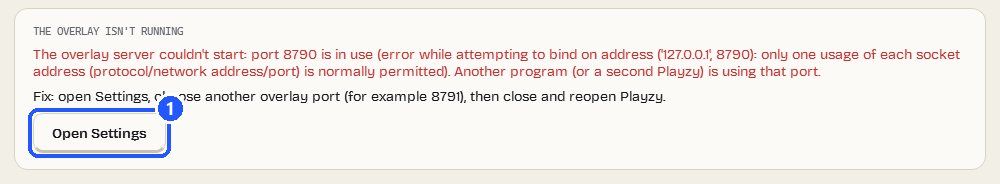

Playzy must be open, on the same PC as LIVE Studio or OBS. If the Overlay page says **The overlay isn't running**, another program (or a second Playzy) uses port 8790:

1. Click **Open Settings**.
2. Under **Overlay server**, type another port, for example 8791.
3. Close Playzy and open it again.
4. Copy the new overlay link into LIVE Studio or OBS. The old link has the old port in it.

### Text to speech is silent

- **Speak out loud** must be ticked on the Voice & sounds page, and the rule needs a **Say** line.
- If the Voice page says no voices were found, add one in Windows **Settings > Time & language > Speech**.
- Check your PC's sound output and volume. **Test voice** should speak.

### Where the logs are

| Log | Where |
|---|---|
| Playzy | `%LOCALAPPDATA%\Playzy\logs\playzy.log` (**Settings > Open logs folder**) |
| Playzy, if it crashed | `%LOCALAPPDATA%\Playzy\logs\crash.log` |
| The GTA V script | `GTA V\scripts\PlayzyGTA.log` |
| ScriptHookVDotNet | `GTA V\ScriptHookVDotNet.log` |

When you ask for help, send `playzy.log`. It has no passwords in it: Playzy never has your TikTok password.

## 20. Updating and uninstalling

- **Updating:** a few seconds after Playzy starts, it checks whether a new version is out. If there is one, a window shows what's new. Click **Download & install**. Windows asks for permission once, Playzy closes, installs the update and opens again. **Later** skips it for now. You can also click **Check for updates** in Settings.
- **After an update**, Playzy puts its newer GTA V script into your GTA V folder by itself the next time it starts, and keeps your `PlayzyGTA.ini`. If GTA V was already running, press **Insert** in the game once to load it.
- **Uninstalling:** use Windows **Settings > Apps > Playzy > Uninstall**. Your settings, presets and logs are kept, in case you come back. Delete `%LOCALAPPDATA%\Playzy` yourself if you want them gone. The GTA V script stays in `GTA V\scripts` until you delete `PlayzyGTA.3.cs` and `PlayzyGTA.ini`.

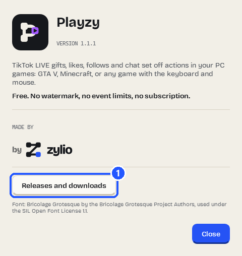

1. **Releases and downloads** opens the releases page, with every version and what changed.

## 21. Privacy and where your files are

- **No account, no analytics, no tracking.** Playzy has nothing to sign up for and sends nothing about you to zylio.
- **TikTok:** Playzy reads your LIVE with the open-source TikTokLive library, using only your TikTok name. The library asks the [Euler Stream](https://www.eulerstream.com) signing service to sign each connection, so your TikTok name goes to Euler Stream, and your Sign API key if you added one.
- **Updates:** Playzy asks GitHub whether a newer version exists. Nothing is downloaded until you click.
- **Local only:** the overlay and the Mod SDK answer only your own PC (`127.0.0.1`). So does the GTA V script, on port 8766 (or the next free one).
- **Minecraft and webhooks** connect only to the addresses you type.
- **Text to speech** uses Windows' own voices, on your PC.
- **The overlay** shows gift pictures and viewers' profile pictures, loaded from TikTok's servers. The Playzy window itself shows initials instead.

| What | Where |
|---|---|
| Settings, presets, the gift list, logs | `%LOCALAPPDATA%\Playzy` |
| The app itself | `C:\Program Files\Playzy` |
| The GTA V script, its settings, score and log | `GTA V\scripts` |

Read the full [privacy policy](../privacy-policy.html).

## 22. Questions people ask

**What does it cost?**
Nothing. There is no limit on events or presets, no watermark and no account. The gift spinner, text to speech and the overlays are free too.

**Do I need an account?**
No Playzy account, ever. Playzy only needs your TikTok name, and never your TikTok password.

**Can I get banned?**
In GTA V, use Playzy only in Story Mode. Rockstar bans accounts for mods in GTA Online. In other games, check the game's own rules about tools that press keys, especially games with anti-cheat.

**What about TikTok's rules?**
TikTok's LIVE rules don't allow begging for gifts. Don't ask or push viewers to send them. The gift menu on the overlay already shows what each gift does. Read TikTok's LIVE guidelines yourself; they change.

**Does it work with Kick or YouTube?**
Not yet. Only TikTok for now.

**Does Playzy stream my video?**
No. You go live with TikTok LIVE Studio or OBS, as before. Playzy reads the LIVE and drives the game.

**Why does a gift have a different name in Playzy?**
TikTok names gifts by region. The default presets use the English names. Change a rule's gift name to the one your LIVE shows.

**Can I share my preset?**
Yes. **Export…** on the Presets page saves it as a `.json` file. Your friend clicks **Import…**.

## 23. Words you will see

| Word | Meaning |
|---|---|
| **Preset** | Your list of rules, for one game or one stream idea. |
| **Rule** | "When this happens, do that." |
| **Trigger** | The "when" part: a gift, likes, a follow, a share, a join or a chat command. |
| **Action** | One thing that happens in the game, like a tank or a key press. |
| **Connector** | The part of Playzy that talks to one game: GTA V, Minecraft, Keyboard & mouse, Webhook, or a mod. |
| **Combo** | A viewer sending the same gift many times in a row, like Rose x10. |
| **Cooldown** | Seconds a rule waits before it can run again. |
| **Coins** | What a gift costs the viewer on TikTok. |
| **Session** | The counting since you pressed New session or opened Playzy. |
| **Overlay** | The graphics on top of your stream: gift menu, alerts, the wheel, the HUD. |
| **HUD** | The game box on the overlay: challenge, health, wins and losses. |
| **Challenge** | A GTA V game mode with a goal, like Zombie Apocalypse. You win or lose rounds, and the overlay keeps the score. |
| **Stand-in** | The effect a challenge runs instead of a gift that doesn't fit it, so the gift isn't wasted. |
| **Story Mode** | GTA V's single-player game. The only place to use mods. |
| **ScriptHookV** | The free mod loader that lets scripts run in GTA V. |
| **ScriptHookVDotNet** | The loader for scripts like Playzy's, on top of ScriptHookV. |
| **RCON** | A Minecraft server's remote console. Playzy sends commands through it. |
| **Port** | A number that tells programs on the same PC how to find each other, like 8790 for the overlay. |

## 24. Get help

- **Email:** [support@zylio.net](mailto:support@zylio.net). Say what you tried, and attach `playzy.log` (and `PlayzyGTA.log` for GTA V problems).
- **Website:** [zylio.net/software/playzy](https://zylio.net/software/playzy)
- **Downloads and what's new:** [the releases page](https://github.com/faisalrasheed442/playzy-public/releases)

Playzy is free and made by one person at zylio. Thanks to the people behind TikTokLive, ScriptHookV and ScriptHookVDotNet, which make it possible.
